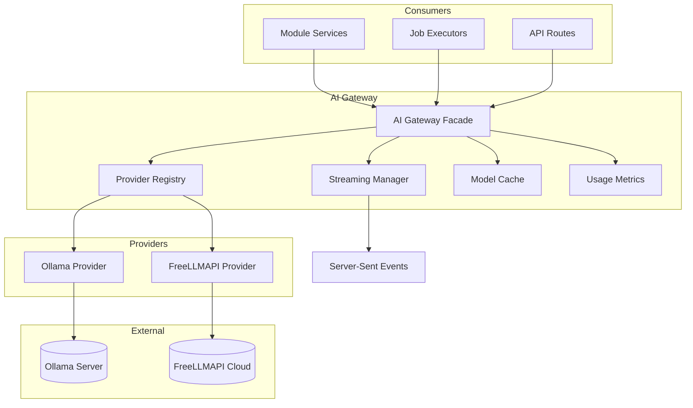
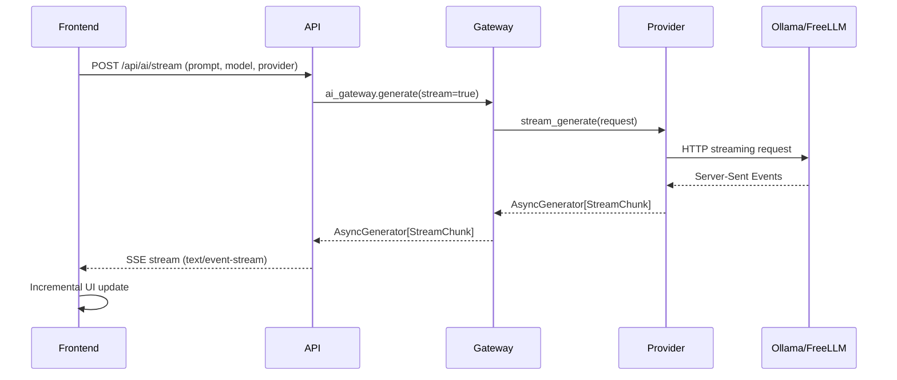

# Local AI Studio — AI Provider Architecture

## Overview

The AI Provider Gateway is the **central abstraction layer** for all LLM interactions. It provides a unified interface for multiple providers (Ollama local, FreeLLMAPI remote) with support for streaming, model management, and automatic failover. Designed for 8 GB RAM constraints with sequential request processing.

## Architecture Diagram



## Core Interfaces

### Unified Request/Response

```python
# src/core/ai_gateway/schemas.py
from dataclasses import dataclass, field
from typing import Optional, AsyncGenerator, Literal
from pydantic import BaseModel, Field
from enum import Enum


class ProviderName(str, Enum):
    OLLAMA = "ollama"
    FREELLM = "freellmapi"


class ModelCapability(str, Enum):
    CHAT = "chat"
    COMPLETION = "completion"
    EMBEDDING = "embedding"
    VISION = "vision"
    TOOLS = "tools"


@dataclass
class ModelInfo:
    id: str
    name: str
    provider: ProviderName
    size_bytes: int = 0
    modified_at: str = ""
    capabilities: list[ModelCapability] = field(default_factory=list)
    context_length: int = 4096
    description: str = ""


@dataclass
class GenerationRequest:
    prompt: str
    model: str
    provider: ProviderName = ProviderName.OLLAMA
    system_prompt: Optional[str] = None
    temperature: float = 0.7
    max_tokens: int = 4096
    top_p: float = 0.9
    top_k: int = 40
    repeat_penalty: float = 1.1
    stream: bool = True
    stop_sequences: list[str] = field(default_factory=list)
    options: dict = field(default_factory=dict)


@dataclass
class GenerationResponse:
    content: str
    model: str
    provider: ProviderName
    usage: "TokenUsage"
    finish_reason: str
    latency_ms: int


@dataclass
class TokenUsage:
    prompt_tokens: int = 0
    completion_tokens: int = 0
    total_tokens: int = 0

    @property
    def estimated_cost_usd(self) -> float:
        """Override in provider-specific responses."""
        return 0.0


@dataclass
class StreamChunk:
    content: str
    done: bool = False
    usage: Optional[TokenUsage] = None
```

### Abstract Provider

```python
# src/core/ai_gateway/base.py
from abc import ABC, abstractmethod
from typing import AsyncGenerator
from src.core.ai_gateway.schemas import (
    ProviderName, ModelInfo, GenerationRequest, GenerationResponse, StreamChunk
)


class AIProvider(ABC):
    """Abstract base class for AI providers."""

    @property
    @abstractmethod
    def name(self) -> ProviderName:
        pass

    @property
    @abstractmethod
    def supports_streaming(self) -> bool:
        pass

    @property
    @abstractmethod
    def supports_pull_model(self) -> bool:
        pass

    @abstractmethod
    async def list_models(self) -> list[ModelInfo]:
        pass

    @abstractmethod
    async def generate(self, request: GenerationRequest) -> GenerationResponse:
        pass

    @abstractmethod
    async def stream_generate(self, request: GenerationRequest) -> AsyncGenerator[StreamChunk, None]:
        pass

    @abstractmethod
    async def health_check(self) -> bool:
        pass

    async def pull_model(self, model: str) -> bool:
        return False

    async def get_model_info(self, model: str) -> ModelInfo | None:
        models = await self.list_models()
        return next((m for m in models if m.id == model), None)
```

## Provider Implementations

### Ollama Provider (Local)

```python
# src/core/ai_gateway/ollama.py
import httpx
import time
from typing import AsyncGenerator
from src.core.ai_gateway.base import AIProvider
from src.core.ai_gateway.schemas import (
    ProviderName, ModelInfo, ModelCapability,
    GenerationRequest, GenerationResponse, StreamChunk, TokenUsage
)


class OllamaProvider(AIProvider):
    name = ProviderName.OLLAMA
    supports_streaming = True
    supports_pull_model = True

    def __init__(self, base_url: str, timeout: int = 300):
        self.base_url = base_url.rstrip("/")
        self.timeout = timeout
        self._client: httpx.AsyncClient | None = None
        self._model_cache: dict[str, ModelInfo] = {}

    @property
    def client(self) -> httpx.AsyncClient:
        if self._client is None:
            self._client = httpx.AsyncClient(timeout=self.timeout)
        return self._client

    async def list_models(self) -> list[ModelInfo]:
        start = time.time()
        try:
            response = await self.client.get(f"{self.base_url}/api/tags")
            response.raise_for_status()
            data = response.json()
            models = []
            for model in data.get("models", []):
                model_info = ModelInfo(
                    id=model["name"],
                    name=model["name"],
                    provider=self.name,
                    size_bytes=model.get("size", 0),
                    modified_at=model.get("modified_at", ""),
                    capabilities=self._infer_capabilities(model["name"]),
                    context_length=self._infer_context_length(model["name"]),
                )
                models.append(model_info)
                self._model_cache[model_info.id] = model_info
            return models
        except Exception as e:
            # Return cached models on error
            return list(self._model_cache.values())

    async def generate(self, request: GenerationRequest) -> GenerationResponse:
        start = time.time()
        payload = self._build_payload(request, stream=False)
        response = await self.client.post(f"{self.base_url}/api/generate", json=payload)
        response.raise_for_status()
        data = response.json()
        latency = int((time.time() - start) * 1000)

        return GenerationResponse(
            content=data.get("response", ""),
            model=request.model,
            provider=self.name,
            usage=TokenUsage(
                prompt_tokens=data.get("prompt_eval_count", 0),
                completion_tokens=data.get("eval_count", 0),
                total_tokens=data.get("prompt_eval_count", 0) + data.get("eval_count", 0),
            ),
            finish_reason=data.get("done_reason", "stop"),
            latency_ms=latency,
        )

    async def stream_generate(self, request: GenerationRequest) -> AsyncGenerator[StreamChunk, None]:
        payload = self._build_payload(request, stream=True)
        async with self.client.stream("POST", f"{self.base_url}/api/generate", json=payload) as response:
            response.raise_for_status()
            async for line in response.aiter_lines():
                if not line.strip():
                    continue
                import json
                data = json.loads(line)
                if "response" in data:
                    yield StreamChunk(
                        content=data["response"],
                        done=data.get("done", False),
                    )
                if data.get("done"):
                    if "prompt_eval_count" in data or "eval_count" in data:
                        yield StreamChunk(
                            content="",
                            done=True,
                            usage=TokenUsage(
                                prompt_tokens=data.get("prompt_eval_count", 0),
                                completion_tokens=data.get("eval_count", 0),
                                total_tokens=data.get("prompt_eval_count", 0) + data.get("eval_count", 0),
                            ),
                        )
                    break

    async def health_check(self) -> bool:
        try:
            response = await self.client.get(f"{self.base_url}/api/version")
            return response.status_code == 200
        except Exception:
            return False

    async def pull_model(self, model: str) -> bool:
        try:
            async with self.client.stream(
                "POST", f"{self.base_url}/api/pull", json={"name": model}
            ) as response:
                async for line in response.aiter_lines():
                    if not line.strip():
                        continue
                    import json
                    data = json.loads(line)
                    if data.get("status") == "success":
                        self._model_cache.clear()
                        return True
                return response.status_code == 200
        except Exception:
            return False

    def _build_payload(self, request: GenerationRequest, stream: bool) -> dict:
        payload = {
            "model": request.model,
            "prompt": request.prompt,
            "temperature": request.temperature,
            "num_predict": request.max_tokens,
            "top_p": request.top_p,
            "top_k": request.top_k,
            "repeat_penalty": request.repeat_penalty,
            "stream": stream,
            "stop": request.stop_sequences or None,
        }
        if request.system_prompt:
            payload["system"] = request.system_prompt
        if request.options:
            payload["options"] = request.options
        return {k: v for k, v in payload.items() if v is not None}

    def _infer_capabilities(self, model_name: str) -> list[ModelCapability]:
        caps = [ModelCapability.CHAT, ModelCapability.COMPLETION]
        name_lower = model_name.lower()
        if any(x in name_lower for x in ["llava", "vision", "moondream", "bakllava", "llama3.2-vision"]):
            caps.append(ModelCapability.VISION)
        if "embed" in name_lower:
            caps.append(ModelCapability.EMBEDDING)
        if any(x in name_lower for x in ["hermes", "function", "tool"]):
            caps.append(ModelCapability.TOOLS)
        return caps

    def _infer_context_length(self, model_name: str) -> int:
        name_lower = model_name.lower()
        if "32k" in name_lower or "128k" in name_lower:
            return 32768
        if "16k" in name_lower:
            return 16384
        if "8k" in name_lower:
            return 8192
        return 4096
```

### FreeLLMAPI Provider (Remote)

```python
# src/core/ai_gateway/freellmapi.py
import httpx
import time
from typing import AsyncGenerator
from src.core.ai_gateway.base import AIProvider
from src.core.ai_gateway.schemas import (
    ProviderName, ModelInfo, ModelCapability,
    GenerationRequest, GenerationResponse, StreamChunk, TokenUsage
)


class FreeLLMAPIProvider(AIProvider):
    name = ProviderName.FREELLM
    supports_streaming = True
    supports_pull_model = False

    # Known models with pricing (USD per 1M tokens)
    KNOWN_MODELS = {
        "gpt-4o-mini": {
            "name": "GPT-4o Mini",
            "capabilities": [ModelCapability.CHAT, ModelCapability.COMPLETION],
            "context": 128000,
            "pricing": {"prompt": 0.15, "completion": 0.60},
        },
        "gpt-4o": {
            "name": "GPT-4o",
            "capabilities": [ModelCapability.CHAT, ModelCapability.COMPLETION, ModelCapability.VISION],
            "context": 128000,
            "pricing": {"prompt": 5.00, "completion": 15.00},
        },
        "gpt-4-turbo": {
            "name": "GPT-4 Turbo",
            "capabilities": [ModelCapability.CHAT, ModelCapability.COMPLETION, ModelCapability.VISION],
            "context": 128000,
            "pricing": {"prompt": 10.00, "completion": 30.00},
        },
        "claude-3-5-sonnet": {
            "name": "Claude 3.5 Sonnet",
            "capabilities": [ModelCapability.CHAT, ModelCapability.COMPLETION],
            "context": 200000,
            "pricing": {"prompt": 3.00, "completion": 15.00},
        },
        "claude-3-haiku": {
            "name": "Claude 3 Haiku",
            "capabilities": [ModelCapability.CHAT, ModelCapability.COMPLETION],
            "context": 200000,
            "pricing": {"prompt": 0.25, "completion": 1.25},
        },
        "gemini-1.5-pro": {
            "name": "Gemini 1.5 Pro",
            "capabilities": [ModelCapability.CHAT, ModelCapability.COMPLETION, ModelCapability.VISION],
            "context": 2000000,
            "pricing": {"prompt": 1.25, "completion": 5.00},
        },
        "gemini-1.5-flash": {
            "name": "Gemini 1.5 Flash",
            "capabilities": [ModelCapability.CHAT, ModelCapability.COMPLETION, ModelCapability.VISION],
            "context": 1000000,
            "pricing": {"prompt": 0.075, "completion": 0.30},
        },
    }

    def __init__(self, base_url: str, api_key: str, timeout: int = 120):
        self.base_url = base_url.rstrip("/")
        self.api_key = api_key
        self.timeout = timeout
        self._client: httpx.AsyncClient | None = None

    @property
    def client(self) -> httpx.AsyncClient:
        if self._client is None:
            self._client = httpx.AsyncClient(
                timeout=self.timeout,
                headers={"Authorization": f"Bearer {self.api_key}"},
            )
        return self._client

    async def list_models(self) -> list[ModelInfo]:
        models = []
        for model_id, info in self.KNOWN_MODELS.items():
            models.append(ModelInfo(
                id=model_id,
                name=info["name"],
                provider=self.name,
                size_bytes=0,
                modified_at="",
                capabilities=info["capabilities"],
                context_length=info["context"],
                description=f"Via FreeLLMAPI - ${info['pricing']['prompt']}/${info['pricing']['completion']} per 1M tokens",
            ))
        return models

    async def generate(self, request: GenerationRequest) -> GenerationResponse:
        start = time.time()
        payload = self._build_payload(request, stream=False)
        response = await self.client.post(f"{self.base_url}/v1/chat/completions", json=payload)
        response.raise_for_status()
        data = response.json()
        latency = int((time.time() - start) * 1000)

        choice = data["choices"][0]
        usage_data = data.get("usage", {})
        model_info = self.KNOWN_MODELS.get(request.model, {})
        pricing = model_info.get("pricing", {"prompt": 0, "completion": 0})

        return GenerationResponse(
            content=choice["message"]["content"],
            model=request.model,
            provider=self.name,
            usage=TokenUsage(
                prompt_tokens=usage_data.get("prompt_tokens", 0),
                completion_tokens=usage_data.get("completion_tokens", 0),
                total_tokens=usage_data.get("total_tokens", 0),
            ),
            finish_reason=choice.get("finish_reason", "stop"),
            latency_ms=latency,
        )

    async def stream_generate(self, request: GenerationRequest) -> AsyncGenerator[StreamChunk, None]:
        payload = self._build_payload(request, stream=True)
        async with self.client.stream("POST", f"{self.base_url}/v1/chat/completions", json=payload) as response:
            response.raise_for_status()
            async for line in response.aiter_lines():
                if not line.strip() or not line.startswith("data: "):
                    continue
                if line.strip() == "data: [DONE]":
                    yield StreamChunk(content="", done=True)
                    break
                import json
                data = json.loads(line[6:])
                delta = data["choices"][0]["delta"]
                if delta.get("content"):
                    yield StreamChunk(content=delta["content"], done=False)

    async def health_check(self) -> bool:
        try:
            response = await self.client.get(f"{self.base_url}/v1/models")
            return response.status_code == 200
        except Exception:
            return False

    def _build_payload(self, request: GenerationRequest, stream: bool) -> dict:
        messages = []
        if request.system_prompt:
            messages.append({"role": "system", "content": request.system_prompt})
        messages.append({"role": "user", "content": request.prompt})

        payload = {
            "model": request.model,
            "messages": messages,
            "temperature": request.temperature,
            "max_tokens": request.max_tokens,
            "top_p": request.top_p,
            "stream": stream,
        }
        if request.stop_sequences:
            payload["stop"] = request.stop_sequences
        return payload
```

## Provider Registry & Facade

```python
# src/core/ai_gateway/registry.py
from typing import Optional
from src.core.ai_gateway.base import AIProvider
from src.core.ai_gateway.ollama import OllamaProvider
from src.core.ai_gateway.freellmapi import FreeLLMAPIProvider
from src.core.ai_gateway.schemas import ProviderName, ModelInfo
from src.config.settings import get_settings
import logging

logger = logging.getLogger(__name__)


class ProviderRegistry:
    def __init__(self):
        self._providers: dict[ProviderName, AIProvider] = {}
        self._initialized = False
        self._model_cache: dict[str, ModelInfo] = {}

    async def initialize(self):
        if self._initialized:
            return
        settings = get_settings()

        # Ollama (always register)
        self._providers[ProviderName.OLLAMA] = OllamaProvider(
            base_url=settings.ollama_base_url,
            timeout=settings.ollama_timeout,
        )

        # FreeLLMAPI (if configured)
        if settings.freellmapi_api_key:
            self._providers[ProviderName.FREELLM] = FreeLLMAPIProvider(
                base_url=settings.freellmapi_base_url,
                api_key=settings.freellmapi_api_key,
                timeout=settings.freellmapi_timeout,
            )

        # Health check all providers
        for name, provider in self._providers.items():
            healthy = await provider.health_check()
            if not healthy:
                logger.warning(f"Provider '{name}' health check failed")
            else:
                logger.info(f"Provider '{name}' is healthy")

        await self._refresh_model_cache()
        self._initialized = True

    def get(self, name: ProviderName) -> Optional[AIProvider]:
        return self._providers.get(name)

    def list_providers(self) -> list[ProviderName]:
        return list(self._providers.keys())

    async def get_all_models(self) -> dict[ProviderName, list[ModelInfo]]:
        result = {}
        for name, provider in self._providers.items():
            try:
                result[name] = await provider.list_models()
            except Exception as e:
                logger.error(f"Error listing models for {name}: {e}")
                result[name] = []
        return result

    async def _refresh_model_cache(self):
        self._model_cache.clear()
        for provider in self._providers.values():
            try:
                models = await provider.list_models()
                for model in models:
                    self._model_cache[model.id] = model
            except Exception:
                pass

    def get_model_info(self, model_id: str) -> Optional[ModelInfo]:
        return self._model_cache.get(model_id)


provider_registry = ProviderRegistry()
```

### AI Gateway Facade

```python
# src/core/ai_gateway/facade.py
from typing import AsyncGenerator, Optional
from src.core.ai_gateway.registry import provider_registry
from src.core.ai_gateway.schemas import (
    ProviderName, ModelInfo, GenerationRequest, GenerationResponse, StreamChunk
)
from src.core.database.repositories.ai_usage import AIUsageRepository
from src.core.database.session import get_session
import time
import logging

logger = logging.getLogger(__name__)


class AIGateway:
    """Central facade for all AI operations."""

    def __init__(self):
        self._initialized = False

    async def initialize(self):
        await provider_registry.initialize()
        self._initialized = True

    # Model Management
    async def list_providers(self) -> list[ProviderName]:
        return provider_registry.list_providers()

    async def list_models(self) -> dict[ProviderName, list[ModelInfo]]:
        return await provider_registry.get_all_models()

    async def get_model_info(self, model_id: str) -> Optional[ModelInfo]:
        return provider_registry.get_model_info(model_id)

    async def pull_model(self, model: str, provider: ProviderName = ProviderName.OLLAMA) -> bool:
        prov = provider_registry.get(provider)
        if not prov or not prov.supports_pull_model:
            return False
        result = await prov.pull_model(model)
        if result:
            await provider_registry._refresh_model_cache()
        return result

    # Generation
    async def generate(
        self,
        prompt: str,
        model: str,
        provider: ProviderName = ProviderName.OLLAMA,
        system_prompt: str | None = None,
        temperature: float = 0.7,
        max_tokens: int = 4096,
        stream: bool = True,
        user_id: str | None = None,
        request_type: str = "chat",
    ) -> GenerationResponse | AsyncGenerator[StreamChunk, None]:
        if not self._initialized:
            await self.initialize()

        prov = provider_registry.get(provider)
        if not prov:
            raise ValueError(f"Provider '{provider}' not available")

        request = GenerationRequest(
            prompt=prompt,
            model=model,
            provider=provider,
            system_prompt=system_prompt,
            temperature=temperature,
            max_tokens=max_tokens,
            stream=stream,
        )

        start = time.time()
        try:
            if stream:
                return self._stream_with_metrics(prov, request, user_id, request_type, start)
            else:
                response = await prov.generate(request)
                await self._record_usage(user_id, provider, model, response.usage, request_type)
                return response
        except Exception as e:
            logger.error(f"Generation failed: {e}")
            raise

    async def _stream_with_metrics(
        self,
        prov: AIProvider,
        request: GenerationRequest,
        user_id: str | None,
        request_type: str,
        start: float,
    ) -> AsyncGenerator[StreamChunk, None]:
        total_content = ""
        prompt_tokens = 0
        completion_tokens = 0

        async for chunk in prov.stream_generate(request):
            if chunk.content:
                total_content += chunk.content
            if chunk.usage:
                prompt_tokens = chunk.usage.prompt_tokens
                completion_tokens = chunk.usage.completion_tokens
            yield chunk

        if user_id:
            from src.core.ai_gateway.schemas import TokenUsage
            usage = TokenUsage(
                prompt_tokens=prompt_tokens,
                completion_tokens=completion_tokens,
                total_tokens=prompt_tokens + completion_tokens,
            )
            await self._record_usage(user_id, request.provider, request.model, usage, request_type)

    async def _record_usage(
        self,
        user_id: str | None,
        provider: ProviderName,
        model: str,
        usage: "TokenUsage",
        request_type: str,
    ):
        if not user_id:
            return
        try:
            async for session in get_session():
                repo = AIUsageRepository(session)
                await repo.create(
                    user_id=user_id,
                    provider=provider.value,
                    model=model,
                    prompt_tokens=usage.prompt_tokens,
                    completion_tokens=usage.completion_tokens,
                    total_tokens=usage.total_tokens,
                    estimated_cost=usage.estimated_cost_usd,
                    request_type=request_type,
                )
                break
        except Exception as e:
            logger.warning(f"Failed to record AI usage: {e}")

    # Provider-specific helpers
    async def health_check(self, provider: ProviderName | None = None) -> dict[ProviderName, bool]:
        if provider:
            prov = provider_registry.get(provider)
            return {provider: await prov.health_check()} if prov else {provider: False}
        return {name: await prov.health_check() for name, prov in provider_registry._providers.items()}


ai_gateway = AIGateway()
```

## Streaming Architecture



### SSE Endpoint

```python
# src/api/routes/ai.py
from fastapi import APIRouter, HTTPException, Depends
from fastapi.responses import StreamingResponse
from pydantic import BaseModel
from src.core.ai_gateway.facade import ai_gateway
from src.core.ai_gateway.schemas import ProviderName, StreamChunk

router = APIRouter()


class StreamRequest(BaseModel):
    prompt: str
    model: str
    provider: ProviderName = ProviderName.OLLAMA
    system_prompt: str | None = None
    temperature: float = 0.7
    max_tokens: int = 4096


@router.post("/stream")
async def stream_generate(request: StreamRequest, user_id: str = Depends(get_current_user)):
    if not await ai_gateway._initialized:
        await ai_gateway.initialize()

    generator = await ai_gateway.generate(
        prompt=request.prompt,
        model=request.model,
        provider=request.provider,
        system_prompt=request.system_prompt,
        temperature=request.temperature,
        max_tokens=request.max_tokens,
        stream=True,
        user_id=user_id,
    )

    async def sse_generator():
        async for chunk in generator:
            if chunk.done:
                yield "data: [DONE]\n\n"
            else:
                # Escape newlines for SSE
                content = chunk.content.replace("\n", "\\n").replace("\r", "")
                yield f"data: {content}\n\n"

    return StreamingResponse(sse_generator(), media_type="text/event-stream")
```

## Model Selection Strategy

```python
# src/core/ai_gateway/selection.py
from dataclasses import dataclass
from src.core.ai_gateway.schemas import ProviderName, ModelInfo, ModelCapability


@dataclass
class ModelSelectionCriteria:
    require_vision: bool = False
    require_tools: bool = False
    max_context: int = 0
    prefer_local: bool = True
    max_cost_per_1m: float | None = None  # USD


class ModelSelector:
    def __init__(self, gateway):
        self.gateway = gateway

    async def select_best_model(self, criteria: ModelSelectionCriteria) -> ModelInfo | None:
        all_models = await self.gateway.list_models()
        candidates = []

        for provider, models in all_models.items():
            for model in models:
                if not self._matches_criteria(model, criteria):
                    continue

                score = self._score_model(model, criteria, provider)
                candidates.append((score, model))

        if not candidates:
            return None

        candidates.sort(key=lambda x: x[0], reverse=True)
        return candidates[0][1]

    def _matches_criteria(self, model: ModelInfo, criteria: ModelSelectionCriteria) -> bool:
        if criteria.require_vision and ModelCapability.VISION not in model.capabilities:
            return False
        if criteria.require_tools and ModelCapability.TOOLS not in model.capabilities:
            return False
        if criteria.max_context and model.context_length < criteria.max_context:
            return False
        return True

    def _score_model(self, model: ModelInfo, criteria: ModelSelectionCriteria, provider: ProviderName) -> float:
        score = 0.0

        # Prefer local
        if criteria.prefer_local and provider == ProviderName.OLLAMA:
            score += 100

        # Context length bonus
        score += min(model.context_length / 1000, 50)

        # Capability bonuses
        if ModelCapability.VISION in model.capabilities:
            score += 10
        if ModelCapability.TOOLS in model.capabilities:
            score += 10

        # Cost penalty (for remote)
        if provider == ProviderName.FREELLM and criteria.max_cost_per_1m:
            model_info = self._get_freellm_pricing(model.id)
            if model_info:
                avg_cost = (model_info["prompt"] + model_info["completion"]) / 2
                if avg_cost > criteria.max_cost_per_1m:
                    score -= 100

        return score

    def _get_freellm_pricing(self, model_id: str) -> dict | None:
        from src.core.ai_gateway.freellmapi import FreeLLMAPIProvider
        return FreeLLMAPIProvider.KNOWN_MODELS.get(model_id, {}).get("pricing")
```

## Usage Metrics & Cost Tracking

```python
# src/core/database/models/ai_usage.py (extended)
from sqlalchemy import String, Integer, Float, ForeignKey, Index, DateTime, func
from sqlalchemy.orm import Mapped, mapped_column, relationship
from src.core.database.base import Base, UUIDMixin, TimestampMixin


class AIUsageLog(Base, UUIDMixin, TimestampMixin):
    __tablename__ = "ai_usage_logs"

    user_id: Mapped[str] = mapped_column(ForeignKey("users.id", ondelete="CASCADE"), nullable=False, index=True)
    provider: Mapped[str] = mapped_column(String(50), nullable=False)
    model: Mapped[str] = mapped_column(String(100), nullable=False)
    prompt_tokens: Mapped[int] = mapped_column(Integer, default=0, nullable=False)
    completion_tokens: Mapped[int] = mapped_column(Integer, default=0, nullable=False)
    total_tokens: Mapped[int] = mapped_column(Integer, default=0, nullable=False)
    estimated_cost: Mapped[float] = mapped_column(Float, default=0.0, nullable=False)
    request_type: Mapped[str] = mapped_column(String(50), nullable=False)
    latency_ms: Mapped[int | None] = mapped_column(Integer, nullable=True)
    success: Mapped[bool] = mapped_column(default=True, nullable=False)
    error_message: Mapped[str | None] = mapped_column(String(500), nullable=True)

    user: Mapped["User"] = relationship(back_populates="ai_usage_logs")

    __table_args__ = (
        Index("ix_ai_usage_user_provider", "user_id", "provider"),
        Index("ix_ai_usage_user_model", "user_id", "model"),
        Index("ix_ai_usage_created", "created_at"),
        Index("ix_ai_usage_type_date", "request_type", "created_at"),
    )
```

```python
# src/core/ai_gateway/metrics.py
from dataclasses import dataclass
from datetime import datetime, timedelta
from src.core.database.repositories.ai_usage import AIUsageRepository
from src.core.database.session import get_session


@dataclass
class UsageSummary:
    total_requests: int
    total_tokens: int
    total_cost: float
    by_provider: dict
    by_model: dict
    by_type: dict
    avg_latency_ms: float
    success_rate: float


class UsageMetrics:
    def __init__(self):
        pass

    async def get_user_summary(self, user_id: str, days: int = 30) -> UsageSummary:
        since = datetime.utcnow() - timedelta(days=days)
        async for session in get_session():
            repo = AIUsageRepository(session)
            logs = await repo.get_user_logs_since(user_id, since)
            break

        if not logs:
            return UsageSummary(0, 0, 0.0, {}, {}, {}, 0.0, 1.0)

        total_requests = len(logs)
        total_tokens = sum(log.total_tokens for log in logs)
        total_cost = sum(log.estimated_cost for log in logs)
        successful = [log for log in logs if log.success]
        avg_latency = sum(log.latency_ms or 0 for log in successful) / len(successful) if successful else 0

        by_provider = {}
        by_model = {}
        by_type = {}

        for log in logs:
            by_provider[log.provider] = by_provider.get(log.provider, 0) + log.total_tokens
            by_model[log.model] = by_model.get(log.model, 0) + log.total_tokens
            by_type[log.request_type] = by_type.get(log.request_type, 0) + 1

        return UsageSummary(
            total_requests=total_requests,
            total_tokens=total_tokens,
            total_cost=total_cost,
            by_provider=by_provider,
            by_model=by_model,
            by_type=by_type,
            avg_latency_ms=avg_latency,
            success_rate=len(successful) / total_requests,
        )
```

## Resource Constraints & Optimizations

| Constraint | Mitigation |
|------------|------------|
| **8 GB RAM** | Single concurrent request; sequential job queue; model cache in memory |
| **No GPU** | Use quantized models (q4_k_m); offload large models to FreeLLMAPI |
| **Local inference** | Default to 3B models; 7B only on demand |
| **Network latency** | FreeLLMAPI timeout 120s; local Ollama timeout 300s |
| **Token costs** | Track usage per user/module; alert on thresholds |

## Configuration

```python
# src/config/settings.py (AI section)
class Settings(BaseSettings):
    # Ollama
    ollama_base_url: str = "http://localhost:11434"
    ollama_timeout: int = 300
    ollama_default_model: str = "qwen2.5-coder:3b"

    # FreeLLMAPI
    freellmapi_base_url: str = "https://api.freellmapi.xyz"
    freellmapi_api_key: str = ""  # From env
    freellmapi_timeout: int = 120
    freellmapi_default_model: str = "gpt-4o-mini"

    # Gateway
    ai_default_provider: ProviderName = ProviderName.OLLAMA
    ai_max_concurrent_requests: int = 1
    ai_request_timeout: int = 300
```

## Testing Strategy

```python
# tests/test_ai_gateway.py
import pytest
from unittest.mock import AsyncMock, MagicMock
from src.core.ai_gateway.ollama import OllamaProvider
from src.core.ai_gateway.freellmapi import FreeLLMAPIProvider
from src.core.ai_gateway.schemas import GenerationRequest, ProviderName


@pytest.fixture
def mock_ollama():
    provider = OllamaProvider("http://localhost:11434")
    provider.client = AsyncMock()
    return provider


@pytest.fixture
def mock_freellm():
    provider = FreeLLMAPIProvider("https://api.freellmapi.xyz", "test-key")
    provider.client = AsyncMock()
    return provider


async def test_ollama_generate(mock_ollama):
    mock_ollama.client.post.return_value.json.return_value = {
        "response": "Hello, world!",
        "prompt_eval_count": 10,
        "eval_count": 5,
        "done_reason": "stop",
    }
    request = GenerationRequest(prompt="Hi", model="qwen2.5-coder:3b")
    response = await mock_ollama.generate(request)
    assert response.content == "Hello, world!"
    assert response.usage.total_tokens == 15


async def test_freellm_stream(mock_freellm):
    # Mock streaming response
    async def mock_stream(*args, **kwargs):
        class MockResponse:
            async def aiter_lines(self):
                yield 'data: {"choices":[{"delta":{"content":"Hello"}}]}'
                yield 'data: {"choices":[{"delta":{"content":" world"}}]}'
                yield 'data: [DONE]'
        return MockResponse()
    mock_freellm.client.stream = mock_stream

    request = GenerationRequest(prompt="Hi", model="gpt-4o-mini", stream=True)
    chunks = []
    async for chunk in mock_freellm.stream_generate(request):
        chunks.append(chunk.content)
    assert chunks == ["Hello", " world"]
```

---

**Next:** [ADR-001: Tech Stack](../decisions/ADR-001-tech-stack.md) | [ADR-002: Database](../decisions/ADR-002-database.md) | [ADR-003: Job Processing](../decisions/ADR-003-job-processing.md)