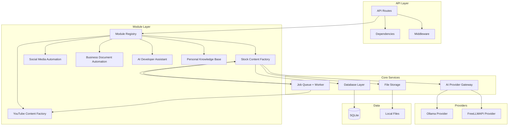
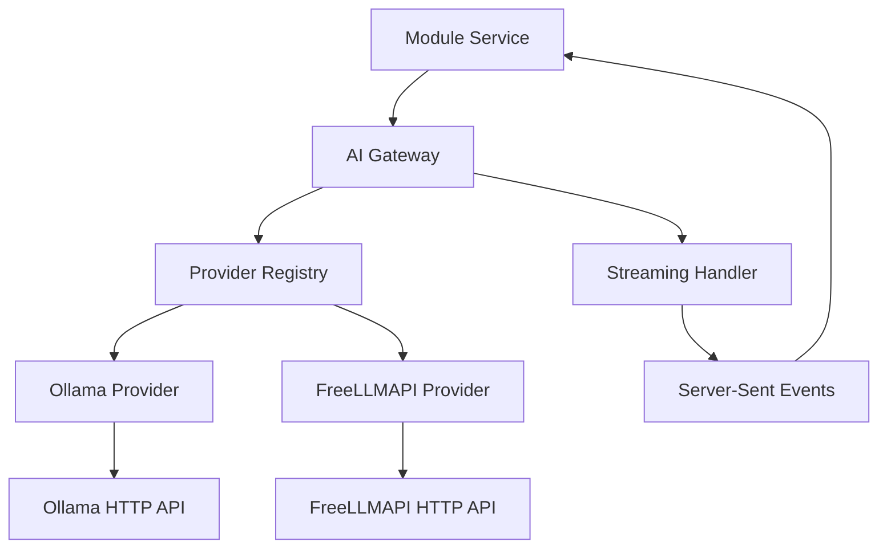
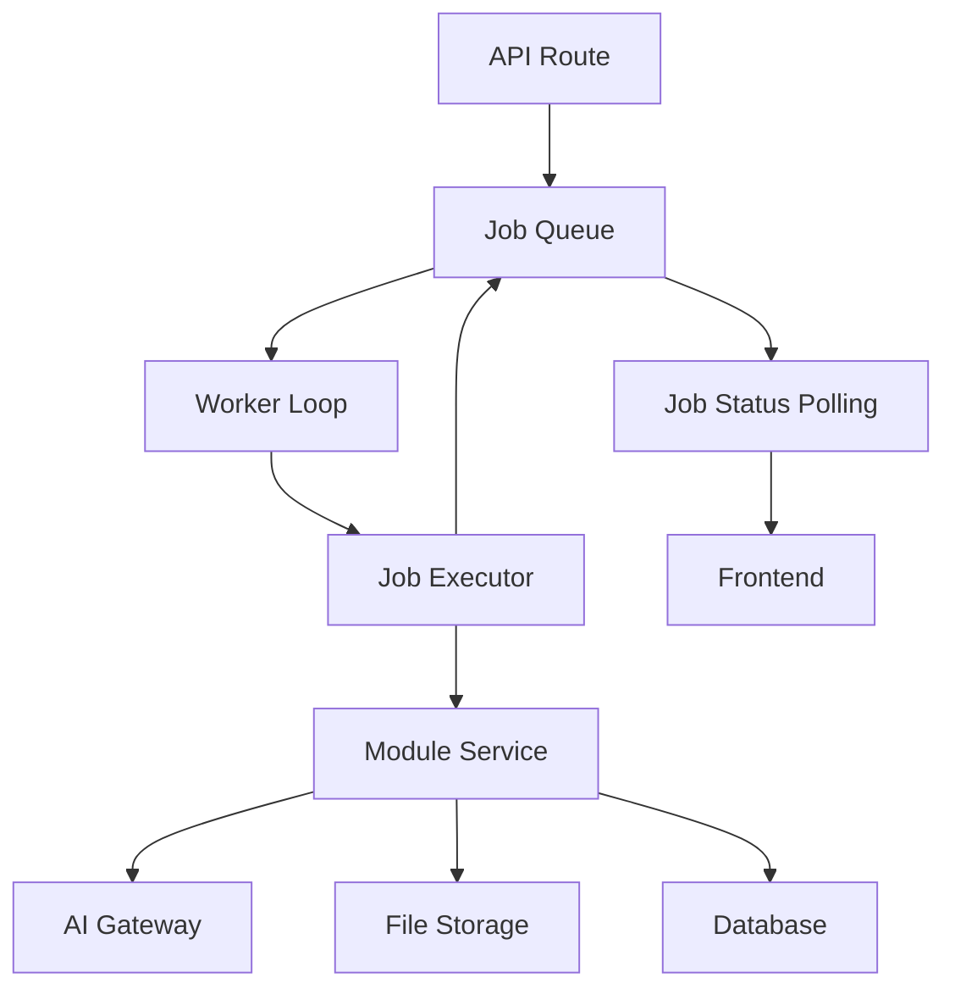

# Local AI Studio — Backend Architecture

## Overview

The backend is a **FastAPI** application built with **Python 3.12**, **Pydantic v2**, **SQLAlchemy 2.x**, and **SQLite**. It follows a modular, service-oriented architecture with clear separation between API routes, business logic, and data access. Designed for local-first operation with zero external infrastructure dependencies.

## Application Structure

```
apps/backend/
├── src/
│   ├── main.py                 # FastAPI app factory
│   ├── config/
│   │   ├── __init__.py
│   │   ├── settings.py         # Pydantic Settings (env-based)
│   │   └── logging.py          # Structured logging config
│   ├── api/
│   │   ├── __init__.py
│   │   ├── routes/
│   │   │   ├── __init__.py
│   │   │   ├── health.py       # Health checks
│   │   │   ├── modules.py      # Module registry
│   │   │   ├── ai.py           # AI streaming & generation
│   │   │   ├── jobs.py         # Background job management
│   │   │   ├── files.py        # File upload/download
│   │   │   └── settings.py     # App settings
│   │   ├── deps.py             # FastAPI dependencies
│   │   └── middleware.py       # CORS, logging, error handling
│   ├── core/
│   │   ├── __init__.py
│   │   ├── ai_gateway/         # AI Provider Gateway
│   │   │   ├── __init__.py
│   │   │   ├── base.py         # Abstract base provider
│   │   │   ├── ollama.py       # Ollama implementation
│   │   │   ├── freellmapi.py   # FreeLLMAPI implementation
│   │   │   ├── registry.py     # Provider registry
│   │   │   └── streaming.py    # Streaming utilities
│   │   ├── jobs/               # Background Job Processor
│   │   │   ├── __init__.py
│   │   │   ├── queue.py        # In-memory priority queue
│   │   │   ├── worker.py       # Sequential worker
│   │   │   ├── models.py       # Job models
│   │   │   └── executor.py     # Job execution logic
│   │   ├── storage/            # File Storage Abstraction
│   │   │   ├── __init__.py
│   │   │   ├── base.py         # Abstract storage
│   │   │   ├── local.py        # Local filesystem implementation
│   │   │   └── models.py       # File metadata models
│   │   └── database/           # Database Layer
│   │       ├── __init__.py
│   │       ├── session.py      # SQLAlchemy async session
│   │       ├── base.py         # Declarative base
│   │       └── migrations/     # Alembic migrations
│   ├── modules/                # Module-specific business logic
│   │   ├── __init__.py
│   │   ├── base.py             # Base module class
│   │   ├── registry.py         # Module registry
│   │   ├── stock_content_factory/
│   │   │   ├── __init__.py
│   │   │   ├── service.py      # Business logic
│   │   │   ├── models.py       # Domain models
│   │   │   ├── schemas.py      # Pydantic schemas
│   │   │   └── routes.py       # Module-specific routes
│   │   └── ... (other modules)
│   ├── shared/
│   │   ├── __init__.py
│   │   ├── exceptions.py       # Custom exceptions
│   │   ├── schemas.py          # Shared Pydantic schemas
│   │   └── utils.py            # Shared utilities
│   └── tests/
│       ├── conftest.py
│       ├── unit/
│       ├── integration/
│       └── fixtures/
├── pyproject.toml
├── uv.lock
├── alembic.ini
└── .env.example
```

## Architecture Diagram



## FastAPI Application Factory

```python
# src/main.py
from contextlib import asynccontextmanager
from fastapi import FastAPI
from fastapi.middleware.cors import CORSMiddleware

from src.config.settings import get_settings
from src.config.logging import setup_logging
from src.api.middleware import LoggingMiddleware, ErrorHandlingMiddleware
from src.api.routes import health, modules, ai, jobs, files, settings as settings_routes
from src.core.database.session import init_db, close_db
from src.core.jobs.worker import job_worker
from src.modules.registry import module_registry


@asynccontextmanager
async def lifespan(app: FastAPI):
    # Startup
    setup_logging()
    settings = get_settings()
    await init_db(settings)
    await module_registry.initialize()
    job_worker.start()
    yield
    # Shutdown
    job_worker.stop()
    await close_db()


def create_app() -> FastAPI:
    settings = get_settings()

    app = FastAPI(
        title="Local AI Studio API",
        description="Local-first AI automation platform backend",
        version="0.1.0",
        lifespan=lifespan,
        docs_url="/docs" if settings.debug else None,
        redoc_url="/redoc" if settings.debug else None,
    )

    # Middleware
    app.add_middleware(CORSMiddleware, **settings.cors_config)
    app.add_middleware(LoggingMiddleware)
    app.add_middleware(ErrorHandlingMiddleware)

    # Routes
    app.include_router(health.router, tags=["health"])
    app.include_router(modules.router, prefix="/api/modules", tags=["modules"])
    app.include_router(ai.router, prefix="/api/ai", tags=["ai"])
    app.include_router(jobs.router, prefix="/api/jobs", tags=["jobs"])
    app.include_router(files.router, prefix="/api/files", tags=["files"])
    app.include_router(settings_routes.router, prefix="/api/settings", tags=["settings"])

    return app


app = create_app()
```

## Configuration (Pydantic Settings)

```python
# src/config/settings.py
from functools import lru_cache
from pathlib import Path
from pydantic import Field, field_validator
from pydantic_settings import BaseSettings, SettingsConfigDict


class Settings(BaseSettings):
    model_config = SettingsConfigDict(
        env_file=".env",
        env_file_encoding="utf-8",
        case_sensitive=False,
        extra="ignore",
    )

    # App
    app_name: str = "Local AI Studio"
    debug: bool = False
    api_host: str = "0.0.0.0"
    api_port: int = 8000

    # Database
    database_url: str = "sqlite+aiosqlite:///./data/local_ai_studio.db"
    database_echo: bool = False

    # AI Providers
    ollama_base_url: str = "http://localhost:11434"
    ollama_timeout: int = 300
    freellmapi_base_url: str = "https://api.freellmapi.xyz"
    freellmapi_timeout: int = 120

    # File Storage
    storage_root: Path = Path("./data/storage")
    max_file_size: int = 100 * 1024 * 1024  # 100 MB
    allowed_extensions: list[str] = [
        ".txt", ".md", ".json", ".csv", ".pdf",
        ".png", ".jpg", ".jpeg", ".gif", ".webp",
        ".mp4", ".webm", ".mov",
    ]

    # Job Processing
    job_worker_interval: float = 1.0
    max_concurrent_jobs: int = 1  # 8 GB RAM constraint

    # CORS
    cors_origins: list[str] = ["http://localhost:3000"]

    @property
    def cors_config(self) -> dict:
        return {
            "allow_origins": self.cors_origins,
            "allow_credentials": True,
            "allow_methods": ["*"],
            "allow_headers": ["*"],
        }

    @field_validator("storage_root", mode="before")
    @classmethod
    def ensure_storage_root(cls, v: str | Path) -> Path:
        path = Path(v).expanduser().resolve()
        path.mkdir(parents=True, exist_ok=True)
        return path


@lru_cache
def get_settings() -> Settings:
    return Settings()
```

## AI Provider Gateway Architecture



### Abstract Base Provider

```python
# src/core/ai_gateway/base.py
from abc import ABC, abstractmethod
from dataclasses import dataclass
from typing import AsyncGenerator, Optional
from pydantic import BaseModel


@dataclass
class ModelInfo:
    id: str
    name: str
    size_bytes: int
    modified_at: str
    capabilities: list[str]  # ["chat", "completion", "embedding", "vision"]


@dataclass
class GenerationRequest:
    prompt: str
    model: str
    system_prompt: Optional[str] = None
    temperature: float = 0.7
    max_tokens: int = 4096
    stream: bool = True
    options: dict = None


@dataclass
class GenerationResponse:
    content: str
    model: str
    provider: str
    usage: dict  # {"prompt_tokens": int, "completion_tokens": int, "total_tokens": int}
    finish_reason: str


class AIProvider(ABC):
    """Abstract base class for AI providers."""

    @property
    @abstractmethod
    def name(self) -> str:
        """Provider identifier: 'ollama' | 'freellmapi'"""
        pass

    @abstractmethod
    async def list_models(self) -> list[ModelInfo]:
        """List available models."""
        pass

    @abstractmethod
    async def generate(self, request: GenerationRequest) -> GenerationResponse:
        """Non-streaming generation."""
        pass

    @abstractmethod
    async def stream_generate(
        self, request: GenerationRequest
    ) -> AsyncGenerator[str, None]:
        """Streaming generation - yields tokens."""
        pass

    @abstractmethod
    async def health_check(self) -> bool:
        """Check provider availability."""
        pass

    async def pull_model(self, model: str) -> bool:
        """Pull/download model (Ollama only). Default: not supported."""
        return False
```

### Ollama Provider

```python
# src/core/ai_gateway/ollama.py
import httpx
from typing import AsyncGenerator
from src.core.ai_gateway.base import AIProvider, ModelInfo, GenerationRequest, GenerationResponse


class OllamaProvider(AIProvider):
    name = "ollama"

    def __init__(self, base_url: str, timeout: int = 300):
        self.base_url = base_url.rstrip("/")
        self.timeout = timeout
        self.client = httpx.AsyncClient(timeout=timeout)

    async def list_models(self) -> list[ModelInfo]:
        response = await self.client.get(f"{self.base_url}/api/tags")
        response.raise_for_status()
        data = response.json()
        return [
            ModelInfo(
                id=model["name"],
                name=model["name"],
                size_bytes=model.get("size", 0),
                modified_at=model.get("modified_at", ""),
                capabilities=self._infer_capabilities(model["name"]),
            )
            for model in data.get("models", [])
        ]

    async def generate(self, request: GenerationRequest) -> GenerationResponse:
        payload = {
            "model": request.model,
            "prompt": request.prompt,
            "system": request.system_prompt,
            "temperature": request.temperature,
            "num_predict": request.max_tokens,
            "stream": False,
            "options": request.options or {},
        }
        response = await self.client.post(f"{self.base_url}/api/generate", json=payload)
        response.raise_for_status()
        data = response.json()
        return GenerationResponse(
            content=data.get("response", ""),
            model=request.model,
            provider=self.name,
            usage={
                "prompt_tokens": data.get("prompt_eval_count", 0),
                "completion_tokens": data.get("eval_count", 0),
                "total_tokens": data.get("prompt_eval_count", 0) + data.get("eval_count", 0),
            },
            finish_reason=data.get("done_reason", "stop"),
        )

    async def stream_generate(
        self, request: GenerationRequest
    ) -> AsyncGenerator[str, None]:
        payload = {
            "model": request.model,
            "prompt": request.prompt,
            "system": request.system_prompt,
            "temperature": request.temperature,
            "num_predict": request.max_tokens,
            "stream": True,
            "options": request.options or {},
        }
        async with self.client.stream(
            "POST", f"{self.base_url}/api/generate", json=payload
        ) as response:
            response.raise_for_status()
            async for line in response.aiter_lines():
                if not line.strip():
                    continue
                import json
                data = json.loads(line)
                if "response" in data:
                    yield data["response"]
                if data.get("done"):
                    break

    async def health_check(self) -> bool:
        try:
            response = await self.client.get(f"{self.base_url}/api/version")
            return response.status_code == 200
        except Exception:
            return False

    async def pull_model(self, model: str) -> bool:
        try:
            async with self.client.stream(
                "POST", f"{self.base_url}/api/pull", json={"name": model}
            ) as response:
                return response.status_code == 200
        except Exception:
            return False

    def _infer_capabilities(self, model_name: str) -> list[str]:
        caps = ["chat", "completion"]
        if any(x in model_name.lower() for x in ["llava", "vision", "moondream"]):
            caps.append("vision")
        if "embed" in model_name.lower():
            caps.append("embedding")
        return caps
```

### FreeLLMAPI Provider

```python
# src/core/ai_gateway/freellmapi.py
import httpx
from typing import AsyncGenerator
from src.core.ai_gateway.base import AIProvider, ModelInfo, GenerationRequest, GenerationResponse


class FreeLLMAPIProvider(AIProvider):
    name = "freellmapi"

    def __init__(self, base_url: str, api_key: str, timeout: int = 120):
        self.base_url = base_url.rstrip("/")
        self.api_key = api_key
        self.timeout = timeout
        self.client = httpx.AsyncClient(
            timeout=timeout,
            headers={"Authorization": f"Bearer {api_key}"},
        )

    async def list_models(self) -> list[ModelInfo]:
        # FreeLLMAPI may not have a models endpoint; return known models
        return [
            ModelInfo(
                id="gpt-4o-mini",
                name="GPT-4o Mini",
                size_bytes=0,
                modified_at="",
                capabilities=["chat", "completion"],
            ),
            ModelInfo(
                id="gpt-4o",
                name="GPT-4o",
                size_bytes=0,
                modified_at="",
                capabilities=["chat", "completion", "vision"],
            ),
            ModelInfo(
                id="claude-3-5-sonnet",
                name="Claude 3.5 Sonnet",
                size_bytes=0,
                modified_at="",
                capabilities=["chat", "completion"],
            ),
        ]

    async def generate(self, request: GenerationRequest) -> GenerationResponse:
        payload = {
            "model": request.model,
            "messages": [
                *([{"role": "system", "content": request.system_prompt}] if request.system_prompt else []),
                {"role": "user", "content": request.prompt},
            ],
            "temperature": request.temperature,
            "max_tokens": request.max_tokens,
            "stream": False,
        }
        response = await self.client.post(
            f"{self.base_url}/v1/chat/completions", json=payload
        )
        response.raise_for_status()
        data = response.json()
        choice = data["choices"][0]
        return GenerationResponse(
            content=choice["message"]["content"],
            model=request.model,
            provider=self.name,
            usage=data.get("usage", {}),
            finish_reason=choice.get("finish_reason", "stop"),
        )

    async def stream_generate(
        self, request: GenerationRequest
    ) -> AsyncGenerator[str, None]:
        payload = {
            "model": request.model,
            "messages": [
                *([{"role": "system", "content": request.system_prompt}] if request.system_prompt else []),
                {"role": "user", "content": request.prompt},
            ],
            "temperature": request.temperature,
            "max_tokens": request.max_tokens,
            "stream": True,
        }
        async with self.client.stream(
            "POST", f"{self.base_url}/v1/chat/completions", json=payload
        ) as response:
            response.raise_for_status()
            async for line in response.aiter_lines():
                if not line.strip() or not line.startswith("data: "):
                    continue
                if line.strip() == "data: [DONE]":
                    break
                import json
                data = json.loads(line[6:])
                if data["choices"][0]["delta"].get("content"):
                    yield data["choices"][0]["delta"]["content"]

    async def health_check(self) -> bool:
        try:
            response = await self.client.get(f"{self.base_url}/v1/models")
            return response.status_code == 200
        except Exception:
            return False
```

### Provider Registry

```python
# src/core/ai_gateway/registry.py
from typing import Optional
from src.core.ai_gateway.base import AIProvider
from src.core.ai_gateway.ollama import OllamaProvider
from src.core.ai_gateway.freellmapi import FreeLLMAPIProvider
from src.config.settings import get_settings


class ProviderRegistry:
    def __init__(self):
        self._providers: dict[str, AIProvider] = {}
        self._initialized = False

    async def initialize(self):
        if self._initialized:
            return
        settings = get_settings()

        # Ollama (always available locally)
        self._providers["ollama"] = OllamaProvider(
            base_url=settings.ollama_base_url,
            timeout=settings.ollama_timeout,
        )

        # FreeLLMAPI (if API key configured)
        if settings.freellmapi_api_key:
            self._providers["freellmapi"] = FreeLLMAPIProvider(
                base_url=settings.freellmapi_base_url,
                api_key=settings.freellmapi_api_key,
                timeout=settings.freellmapi_timeout,
            )

        # Health check all providers
        for name, provider in self._providers.items():
            healthy = await provider.health_check()
            if not healthy:
                print(f"Warning: Provider '{name}' health check failed")

        self._initialized = True

    def get(self, name: str) -> Optional[AIProvider]:
        return self._providers.get(name)

    def list_providers(self) -> list[str]:
        return list(self._providers.keys())

    async def get_all_models(self) -> dict[str, list]:
        result = {}
        for name, provider in self._providers.items():
            try:
                result[name] = await provider.list_models()
            except Exception as e:
                result[name] = []
                print(f"Error listing models for {name}: {e}")
        return result


provider_registry = ProviderRegistry()
```

## Background Job Processing (No Redis)



### Job Models

```python
# src/core/jobs/models.py
from enum import Enum
from dataclasses import dataclass, field
from datetime import datetime
from typing import Any, Optional
import uuid


class JobStatus(str, Enum):
    PENDING = "pending"
    RUNNING = "running"
    COMPLETED = "completed"
    FAILED = "failed"
    CANCELLED = "cancelled"


class JobPriority(int, Enum):
    LOW = 0
    NORMAL = 50
    HIGH = 100


@dataclass
class Job:
    id: str = field(default_factory=lambda: str(uuid.uuid4()))
    type: str = ""
    payload: dict = field(default_factory=dict)
    status: JobStatus = JobStatus.PENDING
    priority: JobPriority = JobPriority.NORMAL
    progress: float = 0.0
    result: Optional[dict] = None
    error: Optional[str] = None
    created_at: datetime = field(default_factory=datetime.utcnow)
    started_at: Optional[datetime] = None
    completed_at: Optional[datetime] = None
    module_id: Optional[str] = None
```

### In-Memory Priority Queue

```python
# src/core/jobs/queue.py
import asyncio
import heapq
from collections import deque
from dataclasses import dataclass, field
from typing import Optional
from src.core.jobs.models import Job, JobPriority, JobStatus


@dataclass(order=True)
class PrioritizedJob:
    priority: int
    job: Job = field(compare=False)
    enqueued_at: float = field(compare=False, default=0)


class JobQueue:
    def __init__(self, max_concurrent: int = 1):
        self._queue: list[PrioritizedJob] = []
        self._running: dict[str, Job] = {}
        self._completed: dict[str, Job] = {}
        self._max_concurrent = max_concurrent
        self._lock = asyncio.Lock()
        self._not_empty = asyncio.Condition(self._lock)

    async def enqueue(self, job: Job) -> str:
        async with self._lock:
            heapq.heappush(
                self._queue,
                PrioritizedJob(
                    priority=-job.priority.value,  # Negative for max-heap
                    job=job,
                    enqueued_at=asyncio.get_event_loop().time(),
                ),
            )
            self._not_empty.notify()
        return job.id

    async def dequeue(self) -> Optional[Job]:
        async with self._lock:
            while not self._queue:
                await self._not_empty.wait()

            if len(self._running) >= self._max_concurrent:
                return None

            prioritized = heapq.heappop(self._queue)
            job = prioritized.job
            job.status = JobStatus.RUNNING
            job.started_at = datetime.utcnow()
            self._running[job.id] = job
            return job

    async def complete(self, job_id: str, result: dict = None, error: str = None):
        async with self._lock:
            job = self._running.pop(job_id, None)
            if not job:
                return
            job.status = JobStatus.COMPLETED if error is None else JobStatus.FAILED
            job.result = result
            job.error = error
            job.completed_at = datetime.utcnow()
            job.progress = 1.0
            self._completed[job_id] = job

    async def update_progress(self, job_id: str, progress: float):
        async with self._lock:
            job = self._running.get(job_id)
            if job:
                job.progress = progress

    async def get_job(self, job_id: str) -> Optional[Job]:
        async with self._lock:
            if job_id in self._running:
                return self._running[job_id]
            return self._completed.get(job_id)

    async def list_jobs(self, status: JobStatus = None) -> list[Job]:
        async with self._lock:
            jobs = list(self._running.values()) + list(self._completed.values())
            if status:
                jobs = [j for j in jobs if j.status == status]
            return sorted(jobs, key=lambda j: j.created_at, reverse=True)
```

### Sequential Worker

```python
# src/core/jobs/worker.py
import asyncio
import logging
from typing import Callable, Awaitable
from src.core.jobs.queue import JobQueue
from src.core.jobs.models import Job
from src.modules.registry import module_registry

logger = logging.getLogger(__name__)


class JobWorker:
    def __init__(self, queue: JobQueue, interval: float = 1.0):
        self.queue = queue
        self.interval = interval
        self._task: asyncio.Task | None = None
        self._running = False
        self._executors: dict[str, Callable[[Job], Awaitable[dict]]] = {}

    def register_executor(self, job_type: str, executor: Callable[[Job], Awaitable[dict]]):
        self._executors[job_type] = executor

    def start(self):
        if self._running:
            return
        self._running = True
        self._task = asyncio.create_task(self._run_loop())
        logger.info("Job worker started")

    def stop(self):
        self._running = False
        if self._task:
            self._task.cancel()
        logger.info("Job worker stopped")

    async def _run_loop(self):
        while self._running:
            try:
                job = await self.queue.dequeue()
                if job:
                    await self._execute_job(job)
                else:
                    await asyncio.sleep(self.interval)
            except asyncio.CancelledError:
                break
            except Exception as e:
                logger.error(f"Worker loop error: {e}")
                await asyncio.sleep(self.interval)

    async def _execute_job(self, job: Job):
        executor = self._executors.get(job.type)
        if not executor:
            await self.queue.complete(job.id, error=f"No executor for job type: {job.type}")
            return

        try:
            logger.info(f"Executing job {job.id} (type: {job.type})")
            result = await executor(job)
            await self.queue.complete(job.id, result=result)
            logger.info(f"Job {job.id} completed")
        except Exception as e:
            logger.error(f"Job {job.id} failed: {e}")
            await self.queue.complete(job.id, error=str(e))


job_worker = JobWorker(queue=JobQueue(max_concurrent=1))
```

## Module System

### Base Module

```python
# src/modules/base.py
from abc import ABC, abstractmethod
from dataclasses import dataclass
from typing import Any
from fastapi import APIRouter
from src.core.jobs.queue import JobQueue


@dataclass
class ModuleInfo:
    id: str
    name: str
    description: str
    version: str
    enabled: bool
    routes: list[str]
    job_types: list[str]


class BaseModule(ABC):
    def __init__(self, job_queue: JobQueue):
        self.job_queue = job_queue

    @property
    @abstractmethod
    def info(self) -> ModuleInfo:
        pass

    @abstractmethod
    async def initialize(self):
        pass

    @abstractmethod
    async def shutdown(self):
        pass

    def register_job_executors(self, worker):
        for job_type in self.info.job_types:
            executor = getattr(self, f"execute_{job_type}", None)
            if executor:
                worker.register_executor(job_type, executor)

    def get_routes(self) -> APIRouter:
        return APIRouter()
```

### Module Registry

```python
# src/modules/registry.py
from typing import Optional
from src.modules.base import BaseModule, ModuleInfo
from src.core.jobs.worker import job_worker
from src.core.jobs.queue import JobQueue


class ModuleRegistry:
    def __init__(self):
        self._modules: dict[str, BaseModule] = {}
        self._job_queue = JobQueue(max_concurrent=1)

    async def initialize(self):
        # Import and register modules here
        from src.modules.stock_content_factory import StockContentFactoryModule

        modules = [
            StockContentFactoryModule(self._job_queue),
            # Add other modules as they're implemented
        ]

        for module in modules:
            if module.info.enabled:
                await module.initialize()
                module.register_job_executors(job_worker)
                self._modules[module.info.id] = module

    def get_module(self, module_id: str) -> Optional[BaseModule]:
        return self._modules.get(module_id)

    def list_modules(self) -> list[ModuleInfo]:
        return [m.info for m in self._modules.values()]

    def get_enabled_modules(self) -> list[ModuleInfo]:
        return [m.info for m in self._modules.values() if m.info.enabled]


module_registry = ModuleRegistry()
```

## File Storage Abstraction

```python
# src/core/storage/base.py
from abc import ABC, abstractmethod
from dataclasses import dataclass
from datetime import datetime
from pathlib import Path
from typing import BinaryIO, Optional


@dataclass
class FileMetadata:
    id: str
    filename: str
    path: str
    size: int
    mime_type: str
    module_id: Optional[str]
    created_at: datetime
    checksum: str


class StorageBackend(ABC):
    @abstractmethod
    async def save(self, file: BinaryIO, filename: str, module_id: str = None) -> FileMetadata:
        pass

    @abstractmethod
    async def get(self, file_id: str) -> tuple[BinaryIO, FileMetadata]:
        pass

    @abstractmethod
    async def delete(self, file_id: str) -> bool:
        pass

    @abstractmethod
    async def list(self, module_id: str = None) -> list[FileMetadata]:
        pass

    @abstractmethod
    async def exists(self, file_id: str) -> bool:
        pass
```

```python
# src/core/storage/local.py
import hashlib
import uuid
import aiofiles
from pathlib import Path
from datetime import datetime
from typing import BinaryIO
from src.core.storage.base import StorageBackend, FileMetadata
from src.config.settings import get_settings


class LocalStorage(StorageBackend):
    def __init__(self):
        self.root = get_settings().storage_root
        self.root.mkdir(parents=True, exist_ok=True)

    def _compute_checksum(self, file: BinaryIO) -> str:
        file.seek(0)
        sha256 = hashlib.sha256()
        for chunk in iter(lambda: file.read(8192), b""):
            sha256.update(chunk)
        file.seek(0)
        return sha256.hexdigest()

    async def save(self, file: BinaryIO, filename: str, module_id: str = None) -> FileMetadata:
        file_id = str(uuid.uuid4())
        ext = Path(filename).suffix
        safe_name = f"{file_id}{ext}"
        module_dir = self.root / (module_id or "global")
        module_dir.mkdir(parents=True, exist_ok=True)
        file_path = module_dir / safe_name

        checksum = self._compute_checksum(file)
        size = file.seek(0, 2)
        file.seek(0)

        async with aiofiles.open(file_path, "wb") as f:
            while chunk := file.read(8192):
                await f.write(chunk)

        return FileMetadata(
            id=file_id,
            filename=filename,
            path=str(file_path),
            size=size,
            mime_type=self._guess_mime(ext),
            module_id=module_id,
            created_at=datetime.utcnow(),
            checksum=checksum,
        )

    async def get(self, file_id: str) -> tuple[BinaryIO, FileMetadata]:
        # Find file by ID in metadata DB (simplified)
        # In practice, query database for path
        raise NotImplementedError("Use database lookup for file path")

    async def delete(self, file_id: str) -> bool:
        raise NotImplementedError("Use database lookup for file path")

    async def list(self, module_id: str = None) -> list[FileMetadata]:
        raise NotImplementedError("Query database for file listings")

    async def exists(self, file_id: str) -> bool:
        raise NotImplementedError("Query database for file existence")

    def _guess_mime(self, ext: str) -> str:
        mime_map = {
            ".txt": "text/plain",
            ".md": "text/markdown",
            ".json": "application/json",
            ".pdf": "application/pdf",
            ".png": "image/png",
            ".jpg": "image/jpeg",
            ".jpeg": "image/jpeg",
            ".gif": "image/gif",
            ".webp": "image/webp",
            ".mp4": "video/mp4",
            ".webm": "video/webm",
        }
        return mime_map.get(ext.lower(), "application/octet-stream")
```

## Database Layer

```python
# src/core/database/session.py
from sqlalchemy.ext.asyncio import create_async_engine, AsyncSession, async_sessionmaker
from sqlalchemy.orm import DeclarativeBase
from src.config.settings import get_settings


class Base(DeclarativeBase):
    pass


engine = None
async_session_maker = None


async def init_db(settings=None):
    global engine, async_session_maker
    if settings is None:
        settings = get_settings()
    engine = create_async_engine(
        settings.database_url,
        echo=settings.database_echo,
        pool_pre_ping=True,
    )
    async_session_maker = async_sessionmaker(engine, class_=AsyncSession, expire_on_commit=False)
    async with engine.begin() as conn:
        await conn.run_sync(Base.metadata.create_all)


async def close_db():
    global engine
    if engine:
        await engine.dispose()


async def get_session() -> AsyncSession:
    async with async_session_maker() as session:
        yield session
```

## API Routes Examples

### AI Streaming Endpoint

```python
# src/api/routes/ai.py
from fastapi import APIRouter, Depends, HTTPException
from fastapi.responses import StreamingResponse
from pydantic import BaseModel
from src.core.ai_gateway.registry import provider_registry
from src.core.ai_gateway.base import GenerationRequest

router = APIRouter()


class GenerateRequest(BaseModel):
    prompt: str
    model: str
    provider: str = "ollama"
    system_prompt: str | None = None
    temperature: float = 0.7
    max_tokens: int = 4096
    stream: bool = True


@router.post("/generate")
async def generate(request: GenerateRequest):
    provider = provider_registry.get(request.provider)
    if not provider:
        raise HTTPException(400, f"Provider '{request.provider}' not available")

    gen_request = GenerationRequest(
        prompt=request.prompt,
        model=request.model,
        system_prompt=request.system_prompt,
        temperature=request.temperature,
        max_tokens=request.max_tokens,
        stream=request.stream,
    )

    if request.stream:
        async def token_generator():
            async for token in provider.stream_generate(gen_request):
                yield f"data: {token}\n\n"
            yield "data: [DONE]\n\n"

        return StreamingResponse(token_generator(), media_type="text/event-stream")

    response = await provider.generate(gen_request)
    return response


@router.get("/providers")
async def list_providers():
    return {"providers": provider_registry.list_providers()}


@router.get("/models")
async def list_models():
    return await provider_registry.get_all_models()
```

### Jobs Endpoint

```python
# src/api/routes/jobs.py
from fastapi import APIRouter, HTTPException, Query
from pydantic import BaseModel
from src.core.jobs.queue import JobQueue
from src.core.jobs.models import Job, JobStatus, JobPriority
from src.modules.registry import module_registry

router = APIRouter()
job_queue = JobQueue(max_concurrent=1)


class CreateJobRequest(BaseModel):
    type: str
    payload: dict
    priority: JobPriority = JobPriority.NORMAL
    module_id: str | None = None


@router.post("", response_model=Job)
async def create_job(request: CreateJobRequest):
    module = module_registry.get_module(request.module_id) if request.module_id else None
    if request.module_id and not module:
        raise HTTPException(404, "Module not found")

    job = Job(
        type=request.type,
        payload=request.payload,
        priority=request.priority,
        module_id=request.module_id,
    )
    await job_queue.enqueue(job)
    return job


@router.get("", response_model=list[Job])
async def list_jobs(status: JobStatus | None = None):
    return await job_queue.list_jobs(status)


@router.get("/{job_id}", response_model=Job)
async def get_job(job_id: str):
    job = await job_queue.get_job(job_id)
    if not job:
        raise HTTPException(404, "Job not found")
    return job


@router.get("/{job_id}/progress")
async def get_job_progress(job_id: str):
    job = await job_queue.get_job(job_id)
    if not job:
        raise HTTPException(404, "Job not found")
    return {
        "job_id": job.id,
        "status": job.status,
        "progress": job.progress,
        "result": job.result,
        "error": job.error,
    }
```

## Development Workflow

```bash
# Install dependencies
uv sync

# Run development server
uv run fastapi dev src/main.py

# Run with auto-reload
uv run fastapi run src/main.py --reload

# Type check
uv run mypy src/

# Lint
uv run ruff check src/

# Format
uv run ruff format src/

# Test
uv run pytest

# Database migrations
uv run alembic revision --autogenerate -m "description"
uv run alembic upgrade head
```

## Environment Variables

| Variable | Description | Default |
|----------|-------------|---------|
| `APP_NAME` | Application name | `Local AI Studio` |
| `DEBUG` | Debug mode | `false` |
| `API_HOST` | Bind address | `0.0.0.0` |
| `API_PORT` | Port | `8000` |
| `DATABASE_URL` | SQLite async URL | `sqlite+aiosqlite:///./data/local_ai_studio.db` |
| `OLLAMA_BASE_URL` | Ollama API URL | `http://localhost:11434` |
| `FREELLM_API_KEY` | FreeLLMAPI key | *(from env)* |
| `FREELLM_BASE_URL` | FreeLLMAPI URL | `https://api.freellmapi.xyz` |
| `STORAGE_ROOT` | File storage root | `./data/storage` |
| `MAX_FILE_SIZE` | Max upload size (bytes) | `104857600` |
| `CORS_ORIGINS` | Allowed origins | `http://localhost:3000` |