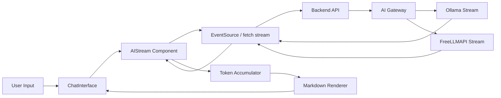

# Local AI Studio — Frontend Architecture

## Overview

The frontend is a **Next.js 16 App Router** application built with **React 19**, **TypeScript strict mode**, and **Tailwind CSS v4**. It follows a component-driven, server-first architecture optimized for local development and AI streaming interactions.

## Application Structure

```
apps/frontend/
├── src/
│   ├── app/                    # App Router routes
│   │   ├── (auth)/             # Route group: auth pages
│   │   ├── (dashboard)/        # Route group: main app
│   │   │   ├── modules/        # Dynamic module routes
│   │   │   │   ├── stock-content-factory/
│   │   │   │   ├── youtube-content-factory/
│   │   │   │   └── ...
│   │   │   ├── settings/
│   │   │   └── layout.tsx      # Dashboard layout with sidebar
│   │   ├── api/                # API routes (proxy to backend)
│   │   ├── globals.css         # Tailwind v4 + CSS variables
│   │   ├── layout.tsx          # Root layout
│   │   └── page.tsx            # Landing / redirect
│   ├── components/
│   │   ├── ui/                 # shadcn/ui components (copied)
│   │   ├── module/             # Module-specific components
│   │   ├── layout/             # Sidebar, header, navigation
│   │   ├── ai/                 # AI streaming, chat components
│   │   └── forms/              # Form components with RHF + Zod
│   ├── lib/
│   │   ├── api/                # API client (TanStack Query)
│   │   ├── ai/                 # AI gateway client
│   │   ├── hooks/              # Custom React hooks
│   │   ├── utils/              # Utility functions
│   │   ├── validations/        # Zod schemas
│   │   └── constants/          # App constants
│   ├── providers/
│   │   ├── query-provider.tsx  # TanStack Query provider
│   │   ├── theme-provider.tsx  # next-themes provider
│   │   └── module-provider.tsx # Module registry provider
│   ├── store/
│   │   ├── ui-store.ts         # Zustand: sidebar, modals, toasts
│   │   └── module-store.ts     # Zustand: active module state
│   └── styles/
│       └── globals.css         # Tailwind v4 entry point
├── public/
├── package.json
├── tsconfig.json
├── next.config.ts
├── tailwind.config.ts
├── eslint.config.mjs
├── prettier.config.mjs
└── vitest.config.ts
```

## Routing Architecture

```mermaid
graph TD
    Root[Root Layout] --> AuthGroup[(auth) Group]
    Root --> DashboardGroup[(dashboard) Group]
    Root --> ApiRoutes[/api/*]

    AuthGroup --> Login[/login]
    AuthGroup --> Register[/register]

    DashboardGroup --> Layout[Dashboard Layout]
    Layout --> Sidebar[Sidebar Navigation]
    Layout --> Header[Header + User Menu]
    Layout --> Main[Main Content Area]

    Main --> Modules[/modules/*]
    Modules --> StockModule[/modules/stock-content-factory]
    Modules --> YouTubeModule[/modules/youtube-content-factory]
    Modules --> SocialModule[/modules/social-media-automation]
    Modules --> DocModule[/modules/business-document-automation]
    Modules --> DevModule[/modules/ai-developer-assistant]
    Modules --> KBModule[/modules/personal-knowledge-base]

    Main --> Settings[/settings]
    Settings --> General[/settings/general]
    Settings --> AIProviders[/settings/ai-providers]
    Settings --> ModulesConfig[/settings/modules]
```

## Component Architecture

### UI Layer (shadcn/ui)

All base components copied from shadcn/ui (not installed as dependency):

```
components/ui/
├── button.tsx
├── input.tsx
├── textarea.tsx
├── select.tsx
├── checkbox.tsx
├── radio-group.tsx
├── switch.tsx
├── slider.tsx
├── progress.tsx
├── toast.tsx
├── sonner.tsx
├── dialog.tsx
├── sheet.tsx
├── dropdown-menu.tsx
├── context-menu.tsx
├── tooltip.tsx
├── popover.tsx
├── hover-card.tsx
├── tabs.tsx
├── accordion.tsx
├── collapsible.tsx
├── scroll-area.tsx
├── separator.tsx
├── avatar.tsx
├── badge.tsx
├── skeleton.tsx
├── table.tsx
├── data-table.tsx
├── card.tsx
├── form.tsx
├── label.tsx
├── navigation-menu.tsx
├── menubar.tsx
├── breadcrumb.tsx
├── pagination.tsx
├── command.tsx
├── input-otp.tsx
└── charts/                 # Recharts wrappers
    ├── area-chart.tsx
    ├── bar-chart.tsx
    ├── line-chart.tsx
    └── pie-chart.tsx
```

### Module Components

Each module defines its own components under `components/module/[module-name]/`:

```
components/module/
├── stock-content-factory/
│   ├── content-generator.tsx
│   ├── template-selector.tsx
│   └── preview-panel.tsx
├── youtube-content-factory/
│   ├── script-editor.tsx
│   ├── thumbnail-generator.tsx
│   └── upload-queue.tsx
└── ...
```

### AI Streaming Components



**Key Components:**

- `AIStream` — Handles Server-Sent Events, token accumulation, abort control
- `StreamingMarkdown` — Incremental markdown rendering with syntax highlighting
- `ModelSelector` — Dropdown to choose local vs remote model per request
- `TokenUsage` — Displays token counts, cost estimates

## State Management

### TanStack Query (Server State)

```typescript
// lib/api/query-client.ts
export const queryClient = new QueryClient({
  defaultOptions: {
    queries: {
      staleTime: 30_000,
      gcTime: 5 * 60_000,
      retry: 1,
      refetchOnWindowFocus: false,
    },
  },
});
```

**Query Keys Structure:**

```typescript
// lib/api/query-keys.ts
export const queryKeys = {
  modules: ["modules"] as const,
  module: (id: string) => ["modules", id] as const,
  aiProviders: ["ai", "providers"] as const,
  aiModels: (provider: string) => ["ai", "models", provider] as const,
  jobs: ["jobs"] as const,
  job: (id: string) => ["jobs", id] as const,
  settings: ["settings"] as const,
} as const;
```

### Zustand (Client State)

Only used for truly global UI state:

```typescript
// store/ui-store.ts
interface UIState {
  sidebarOpen: boolean;
  toggleSidebar: () => void;
  theme: "light" | "dark" | "system";
  setTheme: (theme: Theme) => void;
  toasts: Toast[];
  addToast: (toast: Toast) => void;
}

export const useUIStore = create<UIState>()(
  persist(
    (set) => ({
      sidebarOpen: true,
      toggleSidebar: () => set((s) => ({ sidebarOpen: !s.sidebarOpen })),
      theme: "system",
      setTheme: (theme) => set({ theme }),
      toasts: [],
      addToast: (toast) => set((s) => ({ toasts: [...s.toasts, toast] })),
    }),
    { name: "ui-store" },
  ),
);
```

## Module System Architecture

### Module Registry

```typescript
// lib/modules/registry.ts
interface ModuleDefinition {
  id: string;
  name: string;
  description: string;
  icon: LucideIcon;
  route: string;
  enabled: boolean;
  permissions: string[];
  components: {
    dashboard?: React.ComponentType;
    settings?: React.ComponentType;
  };
  apiRoutes: string[];
}

const modules: ModuleDefinition[] = [
  {
    id: "stock-content-factory",
    name: "Stock Content Factory",
    description: "Generate stock photos, videos, and metadata",
    icon: ImageIcon,
    route: "/modules/stock-content-factory",
    enabled: true,
    permissions: ["ai.generate", "storage.write"],
    components: { dashboard: StockDashboard },
    apiRoutes: ["/api/modules/stock-content-factory"],
  },
  // ...
];

export function getModule(id: string): ModuleDefinition | undefined {
  return modules.find((m) => m.id === id);
}

export function getEnabledModules(): ModuleDefinition[] {
  return modules.filter((m) => m.enabled);
}
```

### Dynamic Module Loading

```typescript
// app/(dashboard)/modules/[moduleId]/page.tsx
export default async function ModulePage({
  params,
}: {
  params: Promise<{ moduleId: string }>;
}) {
  const { moduleId } = await params;
  const module = getModule(moduleId);

  if (!module || !module.enabled) {
    notFound();
  }

  const Dashboard = module.components.dashboard;

  return (
    <ModuleLayout module={module}>
      <Dashboard />
    </ModuleLayout>
  );
}
```

## API Client Architecture

```typescript
// lib/api/client.ts
import { QueryClient } from "@tanstack/react-query";

class APIClient {
  private baseURL: string;

  constructor() {
    this.baseURL = process.env.NEXT_PUBLIC_API_URL || "http://localhost:8000";
  }

  private async request<T>(
    endpoint: string,
    options: RequestInit = {},
  ): Promise<T> {
    const response = await fetch(`${this.baseURL}${endpoint}`, {
      headers: {
        "Content-Type": "application/json",
        ...options.headers,
      },
      ...options,
    });

    if (!response.ok) {
      const error = await response.json().catch(() => ({}));
      throw new APIError(response.status, error.detail || "Request failed");
    }

    return response.json();
  }

  // AI Streaming
  async *streamAI(
    prompt: string,
    model: string,
    provider: "ollama" | "freellmapi",
    options: AIOptions = {},
  ): AsyncGenerator<string> {
    const response = await fetch(`${this.baseURL}/api/ai/stream`, {
      method: "POST",
      headers: { "Content-Type": "application/json" },
      body: JSON.stringify({ prompt, model, provider, ...options }),
    });

    if (!response.ok) throw new Error("Stream failed");

    const reader = response.body?.getReader();
    const decoder = new TextDecoder();

    while (reader) {
      const { done, value } = await reader.read();
      if (done) break;
      yield decoder.decode(value);
    }
  }

  // REST methods
  get<T>(endpoint: string) {
    return this.request<T>(endpoint);
  }
  post<T>(endpoint: string, data: unknown) {
    return this.request<T>(endpoint, {
      method: "POST",
      body: JSON.stringify(data),
    });
  }
  patch<T>(endpoint: string, data: unknown) {
    return this.request<T>(endpoint, {
      method: "PATCH",
      body: JSON.stringify(data),
    });
  }
  delete<T>(endpoint: string) {
    return this.request<T>(endpoint, { method: "DELETE" });
  }
}

export const api = new APIClient();
```

## TanStack Query Hooks

```typescript
// lib/api/hooks/use-modules.ts
export function useModules() {
  return useQuery({
    queryKey: queryKeys.modules,
    queryFn: () => api.get<Module[]>("/api/modules"),
  });
}

export function useModule(id: string) {
  return useQuery({
    queryKey: queryKeys.module(id),
    queryFn: () => api.get<Module>(`/api/modules/${id}`),
    enabled: !!id,
  });
}

export function useCreateJob() {
  return useMutation({
    mutationFn: (job: CreateJobDTO) => api.post<Job>("/api/jobs", job),
    onSuccess: () => {
      queryClient.invalidateQueries({ queryKey: queryKeys.jobs });
    },
  });
}

export function useJobStream(id: string) {
  return useQuery({
    queryKey: ["jobs", id, "stream"],
    queryFn: () => api.get<JobProgress>(`/api/jobs/${id}/progress`),
    refetchInterval: 2000,
    enabled: !!id,
  });
}
```

## Form Architecture (React Hook Form + Zod)

```typescript
// lib/validations/module-settings.ts
export const moduleSettingsSchema = z.object({
  defaultModel: z.string().min(1),
  temperature: z.number().min(0).max(2).default(0.7),
  maxTokens: z.number().min(1).max(32768).default(4096),
  systemPrompt: z.string().max(8000).optional(),
  enableStreaming: z.boolean().default(true),
});

export type ModuleSettings = z.infer<typeof moduleSettingsSchema>;
```

```tsx
// components/forms/module-settings-form.tsx
export function ModuleSettingsForm({
  defaultValues,
}: {
  defaultValues: ModuleSettings;
}) {
  const form = useForm<ModuleSettings>({
    resolver: zodResolver(moduleSettingsSchema),
    defaultValues,
  });

  const mutation = useUpdateModuleSettings();

  return (
    <Form {...form}>
      <form onSubmit={form.handleSubmit(mutation.mutate)}>
        <FormField
          control={form.control}
          name="defaultModel"
          render={({ field }) => (
            <FormItem>
              <FormLabel>Default Model</FormLabel>
              <FormControl>
                <Select
                  onValueChange={field.onChange}
                  defaultValue={field.value}
                >
                  <SelectTrigger>
                    <SelectValue placeholder="Select model" />
                  </SelectTrigger>
                  <SelectContent>
                    {models.map((m) => (
                      <SelectItem key={m.id} value={m.id}>
                        {m.name}
                      </SelectItem>
                    ))}
                  </SelectContent>
                </Select>
              </FormControl>
              <FormMessage />
            </FormItem>
          )}
        />
        {/* ... other fields */}
        <Button type="submit" disabled={mutation.isPending}>
          {mutation.isPending ? "Saving..." : "Save Settings"}
        </Button>
      </form>
    </Form>
  );
}
```

## Theming (Tailwind CSS v4)

```css
/* src/app/globals.css */
@import "tailwindcss";

@theme {
  --color-primary: var(--color-blue-600);
  --color-primary-foreground: var(--color-white);
  --color-secondary: var(--color-slate-100);
  --color-secondary-foreground: var(--color-slate-900);
  --color-destructive: var(--color-red-600);
  --color-destructive-foreground: var(--color-white);
  --color-muted: var(--color-slate-100);
  --color-muted-foreground: var(--color-slate-500);
  --color-accent: var(--color-slate-100);
  --color-accent-foreground: var(--color-slate-900);
  --color-border: var(--color-slate-200);
  --color-ring: var(--color-blue-500);
  --color-background: var(--color-white);
  --color-foreground: var(--color-slate-950);
  --radius: 0.5rem;
}

@media (prefers-color-scheme: dark) {
  :root {
    --color-primary: var(--color-blue-500);
    --color-primary-foreground: var(--color-white);
    --color-secondary: var(--color-slate-800);
    --color-secondary-foreground: var(--color-slate-100);
    --color-destructive: var(--color-red-500);
    --color-destructive-foreground: var(--color-white);
    --color-muted: var(--color-slate-800);
    --color-muted-foreground: var(--color-slate-400);
    --color-accent: var(--color-slate-800);
    --color-accent-foreground: var(--color-slate-100);
    --color-border: var(--color-slate-700);
    --color-ring: var(--color-blue-400);
    --color-background: var(--color-slate-950);
    --color-foreground: var(--color-slate-50);
  }
}

* {
  border-color: var(--color-border);
}

body {
  background-color: var(--color-background);
  color: var(--color-foreground);
}
```

## Performance Optimizations

| Technique              | Implementation                              |
| ---------------------- | ------------------------------------------- |
| **Server Components**  | Default for all non-interactive pages       |
| **Streaming**          | `Suspense` boundaries for slow data         |
| **Code Splitting**     | Dynamic imports for module dashboards       |
| **Image Optimization** | Next.js `Image` component with local loader |
| **Font Optimization**  | `next/font` with variable fonts             |
| **Bundle Analysis**    | `@next/bundle-analyzer` in CI               |
| **Prefetching**        | TanStack Query `prefetchQuery` on hover     |

## Accessibility

- All shadcn/ui components are Radix UI based (WAI-ARIA compliant)
- Semantic HTML structure
- Focus management in dialogs/sheets
- Keyboard navigation for all interactive elements
- Color contrast ratios meet WCAG AA
- `prefers-reduced-motion` respected

## Development Workflow

```bash
# Install dependencies
pnpm install

# Dev server (frontend only)
pnpm --filter frontend dev

# Dev server (full stack via turbo)
pnpm dev

# Type check
pnpm --filter frontend typecheck

# Lint
pnpm --filter frontend lint

# Format
pnpm --filter frontend format

# Test
pnpm --filter frontend test

# Build
pnpm --filter frontend build
```

## Environment Variables

| Variable                     | Description            | Default                 |
| ---------------------------- | ---------------------- | ----------------------- |
| `NEXT_PUBLIC_API_URL`        | Backend API base URL   | `http://localhost:8000` |
| `NEXT_PUBLIC_APP_NAME`       | Application name       | `Local AI Studio`       |
| `NEXT_PUBLIC_DEFAULT_MODULE` | Default module on load | `stock-content-factory` |
