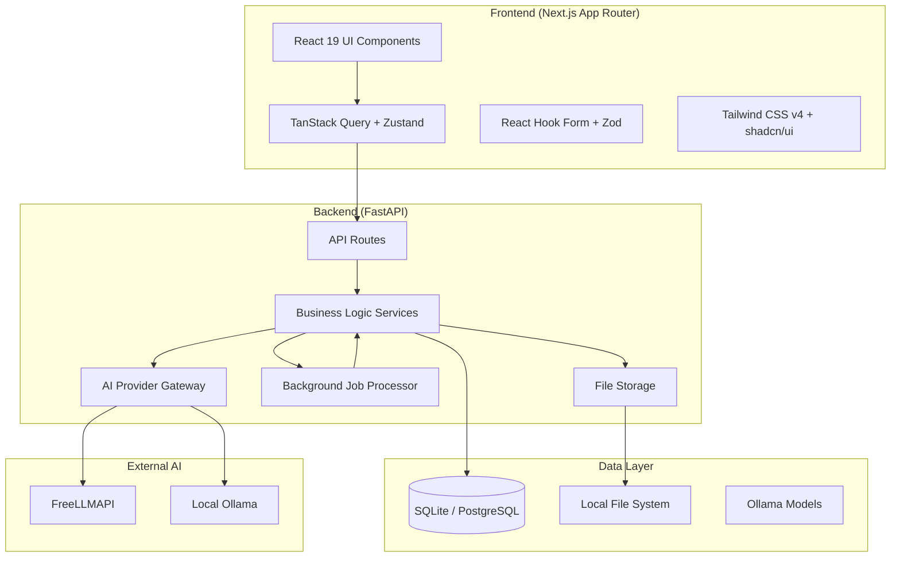

# Local AI Studio — System Overview

## Vision

Local AI Studio is a **local-first, modular AI automation platform** that runs entirely on developer hardware with 8 GB RAM. It provides a unified interface for AI-powered workflows across multiple domains (content creation, social media, document automation, developer assistance, knowledge management) while keeping data local and costs near-zero.

## High-Level Architecture



## Monorepo Structure

```
local-ai-studio/
├── apps/
│   ├── frontend/          # Next.js App Router application
│   └── backend/           # FastAPI application
├── packages/
│   ├── shared/            # Shared types, utilities, constants
│   ├── ui/                # Shared UI components (shadcn/ui based)
│   ├── ai-gateway/        # AI provider abstraction (shared logic)
│   └── config/            # Environment-based configuration
├── docs/
│   ├── architecture/
│   └── decisions/
├── tools/                 # Development scripts, generators
├── pnpm-workspace.yaml
├── turbo.json             # Turborepo config (optional)
├── package.json           # Root workspace config
├── pyproject.toml         # Python workspace config (uv)
└── README.md
```

## Core Design Principles

| Principle | Application |
|-----------|-------------|
| **Local-first** | All data stored locally; external APIs only for LLM inference |
| **Modular** | Each feature domain is an independent module with clear boundaries |
| **Resource-aware** | Designed for 8 GB RAM; no Docker, Redis, or heavy infra |
| **Type-safe** | End-to-end TypeScript + Pydantic v2 contracts |
| **Future-ready** | PostgreSQL migration path; deployment-ready structure |
| **Developer experience** | Fast iteration with pnpm + uv; hot reload everywhere |

## Module Boundaries (Future Modules)

Each future module follows the same internal structure:

```
packages/modules/
├── stock-content-factory/
│   ├── frontend/        # Next.js route groups + components
│   ├── backend/         # FastAPI routers + services
│   ├── domain/          # Pure business logic (no framework deps)
│   └── contracts/       # Zod + Pydantic schemas
├── youtube-content-factory/
├── social-media-automation/
├── business-document-automation/
├── ai-developer-assistant/
└── personal-knowledge-base/
```

## Communication Patterns

| Pattern | Use Case | Implementation |
|---------|----------|----------------|
| **REST API** | Frontend ↔ Backend | FastAPI + TanStack Query |
| **Server-Sent Events** | Streaming AI responses | FastAPI `EventSourceResponse` |
| **Background Jobs** | Long-running tasks | In-process job queue (no Redis) |
| **File System** | Asset storage | Local files with metadata in DB |
| **Shared Types** | Contract enforcement | `packages/shared` + codegen |

## Technology Stack Summary

| Layer | Technology | Version | Rationale |
|-------|------------|---------|-----------|
| **Frontend Framework** | Next.js App Router | 15.x | React 19 ready, Server Components, streaming |
| **Language** | TypeScript | 5.x | Strict mode, inference, developer velocity |
| **Styling** | Tailwind CSS v4 | 4.x | Zero-runtime, modern CSS, OKLCH colors |
| **UI Components** | shadcn/ui | Latest | Accessible, customizable, copy-paste |
| **State Management** | TanStack Query | 5.x | Server state, caching, mutations |
| **Client State** | Zustand | 4.x | Minimal, only when needed |
| **Forms** | React Hook Form + Zod | 7.x / 3.x | Performance, validation |
| **Charts** | Recharts | 2.x | React-native, lightweight |
| **Backend Framework** | FastAPI | 0.115+ | Async, automatic OpenAPI, Pydantic native |
| **Validation** | Pydantic v2 | 2.10+ | Rust-backed, fast, JSON Schema |
| **Settings** | Pydantic Settings | 2.x | Environment-based config |
| **ORM** | SQLAlchemy 2.x | 2.0+ | Async, modern patterns |
| **Migrations** | Alembic | 1.13+ | Version-controlled schema |
| **Database** | SQLite | 3.x | Zero-config, file-based, 8 GB friendly |
| **HTTP Client** | HTTPX | 0.28+ | Async, sync, HTTP/2 |
| **Package Manager (JS)** | pnpm | 9.x | Fast, disk-efficient, monorepo support |
| **Package Manager (Py)** | uv | 0.4+ | 10-100x faster than pip |
| **Linting (JS)** | ESLint | 9.x | Flat config, TypeScript aware |
| **Formatting** | Prettier | 3.x | Consistent style |
| **Linting (Py)** | Ruff | 0.7+ | Fast, replaces flake8/black/isort |
| **Testing (JS)** | Vitest | 2.x | Vite-native, fast |
| **Testing (Py)** | Pytest | 8.x | Standard, fixtures, plugins |
| **CI/CD** | GitHub Actions | Latest | Native GitHub integration |

## Resource Constraints & Mitigations

| Constraint | Mitigation |
|------------|------------|
| **8 GB RAM** | SQLite (not PostgreSQL locally); single Ollama model loaded; no Redis; no Docker; background jobs sequential |
| **No GPU** | Use quantized models (q4_k_m); offload heavy inference to FreeLLMAPI |
| **Disk C: limited** | All caches, models, data on F: drive via env vars |
| **Single concurrent LLM** | Job queue processes one AI task at a time; TanStack Query dedupes requests |

## Non-Functional Requirements

| Requirement | Target |
|-------------|--------|
| **Cold start** | < 3 seconds (frontend + backend) |
| **API latency (local)** | < 100 ms p95 |
| **AI streaming latency** | First token < 500 ms (local) |
| **Bundle size** | < 200 KB gzipped (initial) |
| **Memory (idle)** | < 500 MB total (frontend + backend) |
| **Memory (inference)** | < 6 GB with 7B model loaded |