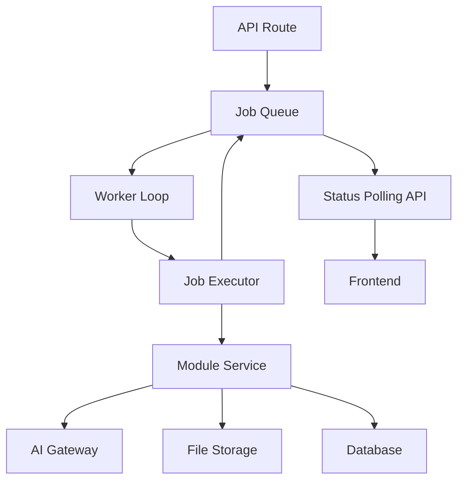

# ADR-003: Background Job Processing Architecture

**Status:** Accepted  
**Date:** 2026-11-24  
**Deciders:** Principal Software Architect  
**Technical Story:** Design background job processing for Local AI Studio without Redis

## Context

Local AI Studio needs to execute long-running AI tasks:
- Content generation (minutes)
- Video/image processing (minutes)
- Batch operations (multiple AI calls)
- File transformations

Constraints:
- **8 GB RAM** — No Redis, no Celery workers
- **Local-first** — Zero external infrastructure
- **Single developer** — Low concurrency needs
- **Sequential AI requests** — One LLM at a time (memory)
- **Type-safe** — Pydantic models for job payloads
- **Observable** — Progress tracking, logs, cancellation

## Decision

**In-process, priority-based job queue with sequential worker**  
**Storage: SQLite (job metadata) + Local filesystem (artifacts)**  
**No external dependencies (Redis, RabbitMQ, Celery)**

## Architecture



## Components

### 1. Job Model

```python
# src/core/jobs/models.py
from enum import Enum as PyEnum
from dataclasses import dataclass, field
from datetime import datetime
from typing import Any, Optional
import uuid


class JobStatus(str, PyEnum):
    PENDING = "pending"
    RUNNING = "running"
    COMPLETED = "completed"
    FAILED = "failed"
    CANCELLED = "cancelled"


class JobPriority(int, PyEnum):
    LOW = 0
    NORMAL = 50
    HIGH = 100


@dataclass
class Job:
    id: str = field(default_factory=lambda: str(uuid.uuid4()))
    type: str = ""                    # e.g., "generate_content", "process_video"
    payload: dict = field(default_factory=dict)  # Typed per job type
    status: JobStatus = JobStatus.PENDING
    priority: JobPriority = JobPriority.NORMAL
    progress: float = 0.0             # 0.0 - 1.0
    result: Optional[dict] = None     # Typed per job type
    error: Optional[str] = None
    created_at: datetime = field(default_factory=datetime.utcnow)
    started_at: Optional[datetime] = None
    completed_at: Optional[datetime] = None
    module_id: Optional[str] = None
    user_id: Optional[str] = None
```

### 2. Priority Queue (In-Memory)

```python
# src/core/jobs/queue.py
import asyncio
import heapq
from dataclasses import dataclass, field
from typing import Optional
from src.core.jobs.models import Job, JobPriority, JobStatus


@dataclass(order=True)
class PrioritizedJob:
    priority: int                    # Negative for max-heap
    job: Job = field(compare=False)
    enqueued_at: float = field(compare=False, default=0)


class JobQueue:
    def __init__(self, max_concurrent: int = 1):
        self._queue: list[PrioritizedJob] = []
        self._running: dict[str, Job] = {}
        self._completed: dict[str, Job] = {}
        self._max_concurrent = max_concurrent
        self._lock = asyncio.Lock()
        self._not_empty = asyncio.Condition(self._lock)

    async def enqueue(self, job: Job) -> str:
        async with self._lock:
            heapq.heappush(
                self._queue,
                PrioritizedJob(
                    priority=-job.priority.value,
                    job=job,
                    enqueued_at=asyncio.get_event_loop().time(),
                ),
            )
            self._not_empty.notify()
        return job.id

    async def dequeue(self) -> Optional[Job]:
        async with self._lock:
            while not self._queue:
                await self._not_empty.wait()

            if len(self._running) >= self._max_concurrent:
                return None

            prioritized = heapq.heappop(self._queue)
            job = prioritized.job
            job.status = JobStatus.RUNNING
            job.started_at = datetime.utcnow()
            self._running[job.id] = job
            return job

    async def complete(self, job_id: str, result: dict = None, error: str = None):
        async with self._lock:
            job = self._running.pop(job_id, None)
            if not job:
                return
            job.status = JobStatus.COMPLETED if error is None else JobStatus.FAILED
            job.result = result
            job.error = error
            job.completed_at = datetime.utcnow()
            job.progress = 1.0
            self._completed[job_id] = job

    async def update_progress(self, job_id: str, progress: float):
        async with self._lock:
            job = self._running.get(job_id)
            if job:
                job.progress = max(0.0, min(1.0, progress))

    async def cancel(self, job_id: str) -> bool:
        async with self._lock:
            # Check running
            if job_id in self._running:
                job = self._running[job_id]
                job.status = JobStatus.CANCELLED
                job.error = "Cancelled by user"
                job.completed_at = datetime.utcnow()
                self._completed[job_id] = self._running.pop(job_id)
                return True
            # Check queued
            for i, pj in enumerate(self._queue):
                if pj.job.id == job_id:
                    job = self._queue.pop(i).job
                    job.status = JobStatus.CANCELLED
                    job.error = "Cancelled before start"
                    job.completed_at = datetime.utcnow()
                    self._completed[job_id] = job
                    return True
            return False

    async def get_job(self, job_id: str) -> Optional[Job]:
        async with self._lock:
            if job_id in self._running:
                return self._running[job_id]
            return self._completed.get(job_id)

    async def list_jobs(
        self, status: JobStatus = None, limit: int = 100
    ) -> list[Job]:
        async with self._lock:
            jobs = list(self._running.values()) + list(self._completed.values())
            if status:
                jobs = [j for j in jobs if j.status == status]
            return sorted(jobs, key=lambda j: j.created_at, reverse=True)[:limit]
```

### 3. Sequential Worker

```python
# src/core/jobs/worker.py
import asyncio
import logging
from typing import Callable, Awaitable
from src.core.jobs.queue import JobQueue
from src.core.jobs.models import Job

logger = logging.getLogger(__name__)


class JobWorker:
    def __init__(self, queue: JobQueue, interval: float = 1.0):
        self.queue = queue
        self.interval = interval
        self._task: asyncio.Task | None = None
        self._running = False
        self._executors: dict[str, Callable[[Job], Awaitable[dict]]] = {}

    def register_executor(self, job_type: str, executor: Callable[[Job], Awaitable[dict]]):
        self._executors[job_type] = executor

    def start(self):
        if self._running:
            return
        self._running = True
        self._task = asyncio.create_task(self._run_loop())
        logger.info("Job worker started")

    def stop(self):
        self._running = False
        if self._task:
            self._task.cancel()
        logger.info("Job worker stopped")

    async def _run_loop(self):
        while self._running:
            try:
                job = await self.queue.dequeue()
                if job:
                    await self._execute_job(job)
                else:
                    await asyncio.sleep(self.interval)
            except asyncio.CancelledError:
                break
            except Exception as e:
                logger.error(f"Worker loop error: {e}")
                await asyncio.sleep(self.interval)

    async def _execute_job(self, job: Job):
        executor = self._executors.get(job.type)
        if not executor:
            await self.queue.complete(job.id, error=f"No executor for job type: {job.type}")
            return

        try:
            logger.info(f"Executing job {job.id} (type: {job.type})")
            result = await executor(job)
            await self.queue.complete(job.id, result=result)
            logger.info(f"Job {job.id} completed")
        except asyncio.CancelledError:
            await self.queue.complete(job.id, error="Cancelled")
        except Exception as e:
            logger.error(f"Job {job.id} failed: {e}")
            await self.queue.complete(job.id, error=str(e))


job_worker = JobWorker(queue=JobQueue(max_concurrent=1))
```

### 4. Job Executors (Module-Level)

```python
# src/modules/stock_content_factory/service.py
from src.core.jobs.models import Job
from src.core.ai_gateway.facade import ai_gateway
from src.core.storage.local import LocalStorage


class StockContentFactoryService:
    def __init__(self):
        self.storage = LocalStorage()

    async def execute_generate_content(self, job: Job) -> dict:
        payload = job.payload
        prompt = payload["prompt"]
        model = payload.get("model", "qwen2.5-coder:3b")
        provider = payload.get("provider", "ollama")
        count = payload.get("count", 1)

        results = []
        for i in range(count):
            # Update progress
            await job_queue.update_progress(job.id, (i + 0.5) / count)

            # Generate content
            response = await ai_gateway.generate(
                prompt=prompt,
                model=model,
                provider=provider,
                stream=False,
                user_id=job.user_id,
                request_type="content_generation",
            )

            # Save output
            file_meta = await self.storage.save(
                file=BytesIO(response.content.encode()),
                filename=f"content_{i+1}.md",
                module_id="stock-content-factory",
            )

            results.append({
                "content": response.content,
                "file_id": file_meta.id,
                "usage": response.usage.__dict__,
            })

        return {"items": results, "total": len(results)}


# Register with worker
def register_job_executors(worker):
    service = StockContentFactoryService()
    worker.register_executor("generate_content", service.execute_generate_content)
```

### 5. API Routes

```python
# src/api/routes/jobs.py
from fastapi import APIRouter, HTTPException, Query, BackgroundTasks
from pydantic import BaseModel, Field
from src.core.jobs.queue import JobQueue
from src.core.jobs.models import Job, JobStatus, JobPriority
from src.modules.registry import module_registry

router = APIRouter()
job_queue = JobQueue(max_concurrent=1)


class CreateJobRequest(BaseModel):
    type: str = Field(..., description="Job type identifier")
    payload: dict = Field(default_factory=dict)
    priority: JobPriority = JobPriority.NORMAL
    module_id: str | None = None


class JobResponse(BaseModel):
    id: str
    type: str
    status: JobStatus
    priority: JobPriority
    progress: float
    payload: dict
    result: dict | None
    error: str | None
    created_at: datetime
    started_at: datetime | None
    completed_at: datetime | None
    module_id: str | None


@router.post("", response_model=JobResponse, status_code=202)
async def create_job(request: CreateJobRequest, user_id: str = Depends(get_current_user)):
    if request.module_id:
        module = module_registry.get_module(request.module_id)
        if not module:
            raise HTTPException(404, "Module not found")

    job = Job(
        type=request.type,
        payload=request.payload,
        priority=request.priority,
        module_id=request.module_id,
        user_id=user_id,
    )
    await job_queue.enqueue(job)
    return job


@router.get("", response_model=list[JobResponse])
async def list_jobs(
    status: JobStatus | None = None,
    module_id: str | None = None,
    limit: int = Query(50, le=200),
    user_id: str = Depends(get_current_user),
):
    jobs = await job_queue.list_jobs(status=status, limit=limit)
    if module_id:
        jobs = [j for j in jobs if j.module_id == module_id]
    return jobs


@router.get("/{job_id}", response_model=JobResponse)
async def get_job(job_id: str, user_id: str = Depends(get_current_user)):
    job = await job_queue.get_job(job_id)
    if not job:
        raise HTTPException(404, "Job not found")
    if job.user_id != user_id:
        raise HTTPException(403, "Not authorized")
    return job


@router.get("/{job_id}/progress")
async def get_job_progress(job_id: str, user_id: str = Depends(get_current_user)):
    job = await job_queue.get_job(job_id)
    if not job:
        raise HTTPException(404, "Job not found")
    if job.user_id != user_id:
        raise HTTPException(403, "Not authorized")
    return {
        "job_id": job.id,
        "status": job.status,
        "progress": job.progress,
        "result": job.result,
        "error": job.error,
    }


@router.post("/{job_id}/cancel")
async def cancel_job(job_id: str, user_id: str = Depends(get_current_user)):
    job = await job_queue.get_job(job_id)
    if not job:
        raise HTTPException(404, "Job not found")
    if job.user_id != user_id:
        raise HTTPException(403, "Not authorized")

    cancelled = await job_queue.cancel(job_id)
    if not cancelled:
        raise HTTPException(400, "Job cannot be cancelled")
    return {"message": "Job cancelled"}
```

### 6. Frontend Integration

```typescript
// lib/api/hooks/use-jobs.ts
export function useCreateJob() {
  return useMutation({
    mutationFn: (job: CreateJobDTO) => api.post<Job>('/api/jobs', job),
    onSuccess: () => {
      queryClient.invalidateQueries({ queryKey: queryKeys.jobs });
    },
  });
}

export function useJobStream(jobId: string, enabled = true) {
  return useQuery({
    queryKey: ['jobs', jobId, 'progress'],
    queryFn: () => api.get<JobProgress>(`/api/jobs/${jobId}/progress`),
    refetchInterval: (data) => data?.status === 'running' ? 1000 : false,
    enabled: enabled && !!jobId,
  });
}
```

```tsx
// components/module/job-progress.tsx
export function JobProgress({ jobId }: { jobId: string }) {
  const { data } = useJobStream(jobId);

  if (!data) return <Skeleton className="h-4 w-full" />;

  return (
    <div className="space-y-2">
      <div className="flex justify-between text-sm">
        <span>{data.status}</span>
        <span>{Math.round(data.progress * 100)}%</span>
      </div>
      <Progress value={data.progress * 100} className="h-2" />
      {data.error && (
        <Alert variant="destructive">
          <AlertDescription>{data.error}</AlertDescription>
        </Alert>
      )}
      {data.result && (
        <Button onClick={() => openResultModal(data.result)}>
          View Result
        </Button>
      )}
    </div>
  );
}
```

## Persistence (SQLite)

Jobs are also persisted to database for durability:

```python
# src/core/database/models/job.py (additions)
class Job(Base, UUIDMixin, TimestampMixin):
    # ... existing fields ...
    
    # Persistence sync happens on enqueue/complete
    # In-memory queue is source of truth for active jobs
    # Database is source of truth for history
```

```python
# src/core/jobs/persistence.py
from src.core.database.repositories.job import JobRepository
from src.core.jobs.models import Job, JobStatus


async def persist_job(job: Job, session: AsyncSession):
    repo = JobRepository(session)
    if job.status == JobStatus.PENDING:
        await repo.create(
            id=job.id,
            type=job.type,
            payload=job.payload,
            status=job.status,
            priority=job.priority,
            module_id=job.module_id,
            user_id=job.user_id,
        )
    else:
        await repo.update(
            job.id,
            status=job.status,
            progress=job.progress,
            result=job.result,
            error=job.error,
            started_at=job.started_at,
            completed_at=job.completed_at,
        )
```

## Comparison with Alternatives

| Approach | Memory | Complexity | Concurrency | Persistence | Chosen? |
|----------|--------|------------|-------------|-------------|---------|
| **In-process queue** | ~1 MB | Low | Sequential | SQLite | ✅ |
| Redis + Celery | 50+ MB | High | Parallel | Redis + DB | ❌ |
| Redis + custom worker | 50+ MB | Medium | Parallel | Redis + DB | ❌ |
| SQLite only (polling) | ~1 MB | Low | Sequential | SQLite | ❌ |
| Temporal.io | 100+ MB | High | Parallel | DB | ❌ |
| Dramatiq + Redis | 30+ MB | Medium | Parallel | Redis + DB | ❌ |

## Consequences

### Positive

- **Zero infrastructure**: No Redis, no message broker
- **Minimal memory**: ~1 MB for queue + worker
- **Simple debugging**: All in one process, standard logging
- **Type-safe**: Pydantic payloads, typed results
- **Observable**: Progress, logs, cancellation built-in
- **Portable**: Works identically local/production

### Negative

- **No horizontal scaling**: Single process only (mitigated: not needed for 8 GB)
- **No durability during crash**: In-flight job lost (mitigated: persist on enqueue/complete)
- **Single-threaded AI**: One LLM at a time (requirement, not limitation)
- **No delayed/scheduled jobs**: Not in v1 (can add with `asyncio.sleep`)

### Risks & Mitigations

| Risk | Mitigation |
|------|------------|
| Job loss on crash | Persist to SQLite on enqueue; recover pending on startup |
| Memory leak | Job results cleared after TTL; limit completed cache |
| Blocking worker | All I/O async; CPU work in `run_in_executor` |
| Priority inversion | Max-heap by priority; FIFO within priority |

## Configuration

```python
# src/config/settings.py
class Settings(BaseSettings):
    job_worker_interval: float = 1.0        # Poll interval
    max_concurrent_jobs: int = 1            # 8 GB constraint
    job_result_ttl_hours: int = 24          # Cleanup old results
    job_max_payload_size: int = 1024 * 1024 # 1 MB
```

## Testing

```python
# tests/test_job_queue.py
import pytest
from src.core.jobs.queue import JobQueue
from src.core.jobs.models import Job, JobPriority, JobStatus


@pytest.mark.asyncio
async def test_priority_ordering():
    queue = JobQueue(max_concurrent=1)
    
    low = Job(type="test", priority=JobPriority.LOW)
    high = Job(type="test", priority=JobPriority.HIGH)
    normal = Job(type="test", priority=JobPriority.NORMAL)
    
    await queue.enqueue(low)
    await queue.enqueue(high)
    await queue.enqueue(normal)
    
    # High should dequeue first
    job = await queue.dequeue()
    assert job.priority == JobPriority.HIGH
    
    job = await queue.dequeue()
    assert job.priority == JobPriority.NORMAL
    
    job = await queue.dequeue()
    assert job.priority == JobPriority.LOW


@pytest.mark.asyncio
async def test_progress_updates():
    queue = JobQueue(max_concurrent=1)
    job = Job(type="test")
    await queue.enqueue(job)
    
    dequeued = await queue.dequeue()
    assert dequeued.progress == 0.0
    
    await queue.update_progress(job.id, 0.5)
    updated = await queue.get_job(job.id)
    assert updated.progress == 0.5
```

---

**Next:** [System Overview](../architecture/system-overview.md) | [Frontend Architecture](../architecture/frontend-architecture.md) | [Backend Architecture](../architecture/backend-architecture.md)